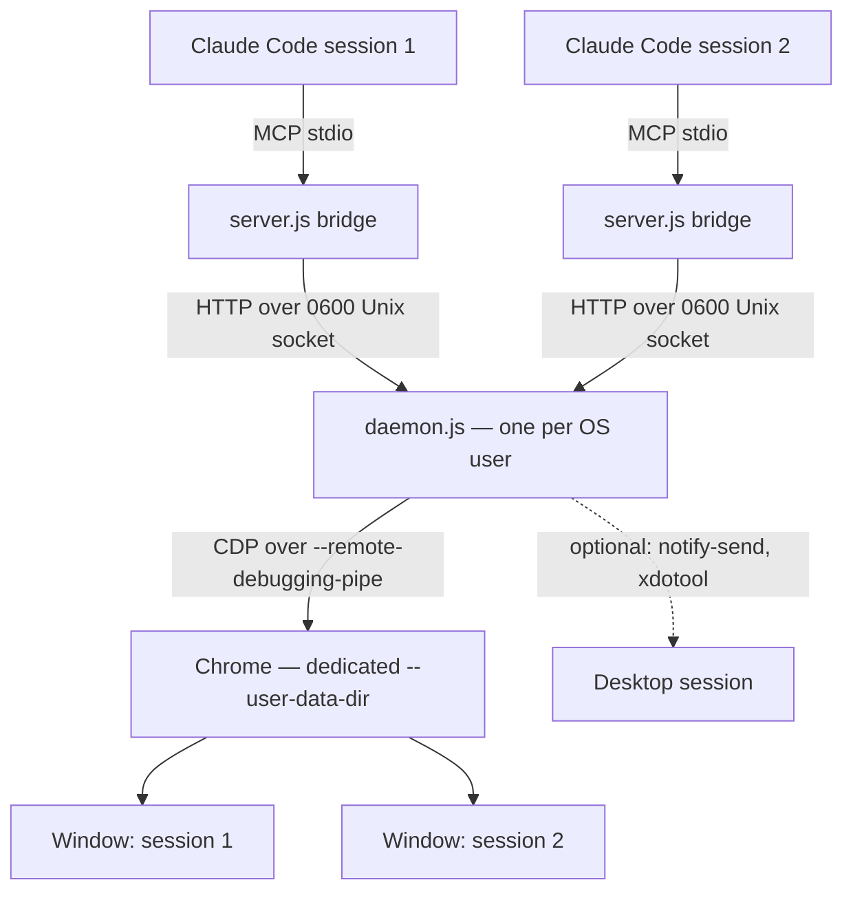

# browsing-overhaul

**Last reviewed**: 2026-09-10
**Status**: Phase 1 LLD committed
**Companions**: [use cases](../use-cases-browsing-overhaul.md) · [future](../future-claudesurf.md)

## Overview

claudesurf's tool contract was built for a demo and has not changed since. `read_page` takes no arguments, returns `document.body.innerText` plus every `<a href>` on the page, and identifies each link by a CSS selector that is often a long `nth-child` path. On a link-dense page that produces tens of thousands of characters, most of them selector noise, which overflows the caller's token budget and spills to a temp file. The interactive half is worse: the tool returns anchors only, so a dashboard's tabs, menu items, and icon-only controls are absent from the output, leaving the agent to guess at a label and hope the text-matching click path finds it. The tool cannot type text.

This project rebuilds the contract around what an agent needs to read a page and act on it. Reads come from Chrome's accessibility tree for structure and control identity, combined with a Readability and Turndown pass for prose, rendered as interleaved markdown where each interactive element carries a ref. Actions address those refs instead of guessed selectors, and the action set grows to cover typing, key presses, option select, history, and tab control. The fifteen actions this implies collapse into two tools — `claudesurf_read` and `claudesurf_act` — so the schema cost in a session's context stays close to today's six tools while the permission boundary between reading and acting stays addressable.

The delivery mechanism changes underneath all of it. claudesurf stops driving the human's everyday Chrome and launches a dedicated instance under its own `--user-data-dir`, and the daemon speaks the DevTools Protocol to that instance over `--remote-debugging-pipe` rather than through a Chrome extension. Deleting the extension removes:

1. The extension WebSocket port and the peer-uid filtering that defends it.
2. The second OS user's separate port configuration.
3. The second user's separate systemd unit.
4. Any need for an MV3 service worker on the read path.

A pipe rides the browser process's own file descriptors, so isolation becomes process ownership and both OS users run an identical shape.

## Key decisions

- **claudesurf drives a dedicated Chrome instance, not the human's everyday browser.** Focus-based multi-profile routing goes with it, since one instance per user leaves the focus probe nothing to choose between.
  - A tool used occasionally must not degrade the everyday browser. A separate `--user-data-dir` defines a Chrome browser process; separate profiles inside one instance share the process and its command line, so a second profile would isolate nothing.
  - The cost is signing in again on each site claudesurf should reach. That cost is paid once per site and buys a containment boundary at the browser: an injection can only reach sessions deliberately placed in that profile. The boundary is the browser's rather than the machine's: the profile's cookie database sits in the same home directory as an agent holding Read and Bash, as risk 4 (home-directory files are agent-writable) concedes for the policy file and the log.

- **The daemon speaks CDP to the browser over `--remote-debugging-pipe`. The Chrome extension is deleted.**
  - Only the parent process holds the pipe's file descriptors, so only the parent can drive the browser. That is stronger than the peer-uid check it replaces, and a pipe stays off the network stack entirely.
  - Tab pinning is the one capability given up — an extension API with no protocol equivalent — so the daemon identifies the working tab by target id recorded at creation. Window creation still raises the window once, since adding the second tab is a page-initiated tab creation and Chrome raises the window for those, and recreating a working tab the human closed raises it the same way, as does any click that opens a tab or popup; nothing else raises it, because pointer input is the other thing that does and clicks are scripted by default.

> [!example]- **Alternatives considered** — a third-party MCP engine, Playwright as a library, a `chrome.debugger` extension, `--remote-debugging-port` (the daemon speaks CDP over a pipe, with no extension)
> Build on Chrome DevTools MCP or Playwright MCP and shrink claudesurf to a policy wrapper — would supply accessibility snapshots, trusted input, settle detection, and network capture ready-made, but chaining MCP servers to inject the nonce, domain policy, and action log is awkward, and the per-session window model would be grafted onto someone else's lifecycle rather than owned. Depend on Playwright as a library rather than as a server — dodges the chaining objection, and lost on keeping the daemon's browser lifecycle its own. Reach CDP through a `chrome.debugger` extension — raises a banner across every window of the browser it attaches to, and puts an MV3 service worker on the correctness path, since the keepalive would have had to hold the debugger session alive. `--remote-debugging-port` — an unauthenticated TCP port carrying full browser authority, reachable by any local process, breaching the per-user isolation the daemon exists to enforce.

- **Reads combine the accessibility tree for controls with a Readability and Turndown pass for prose, the latter run in an isolated world inside the page.** This is the end state, reached in phase 2; the first shipped read is a flat DOM walk over the same isolated world.
  - Chrome already computes accessible names through the full `aria-labelledby`, label-association, `alt`, and `title` chain, and already prunes what is invisible or `aria-hidden`. Reimplementing that would get the hard cases wrong.
  - The accessibility tree drops inline emphasis and code and flattens table structure, because a screen reader gets that from navigation rather than layout. On documentation and articles the loss is material — a config key becomes indistinguishable from an English word, and a wide options table loses which value belongs to which column.
  - Readability needs a DOM. Running it in the daemon would mean jsdom, a heavyweight dependency; running it in the page's own JavaScript context would let page script tamper with the extraction. `Page.createIsolatedWorld` gives a JavaScript context over the same DOM that page script cannot reach, avoiding both costs.
  - CDP reports a `backendDOMNodeId` on accessibility nodes, so both passes derive from the same nodes and placing controls into the rendered prose is a lookup.
  - The `Accessibility` domain is marked experimental in the protocol. Playwright and Chrome DevTools MCP both ship their snapshot on it, which is the evidence that it is stable enough to bet a phase on.

> [!example]- **Alternatives considered** — accessibility tree alone, jsdom in the daemon, the page's own context, a user-selectable format (accessibility tree for controls plus Readability and Turndown in an isolated world)
> Accessibility tree alone — one source of truth and no correspondence problem, at the cost of documentation reading flat and tables occasionally being misread. Run Readability in the daemon over jsdom — keeps all logic server-side, and loses on pulling in a full DOM implementation to re-parse markup the browser has already parsed. Run it in the page's main world — no isolation primitive needed, and page script could tamper with what the agent reads, which the untrusted-content posture rules out. Expose both as a `format` parameter — doubles the surface the agent has to choose between, for a choice it has no basis to make.

- **Reads follow out-of-process iframe targets.**
  - A cross-origin iframe is a separate CDP target, so an accessibility tree pulled on the page target contains nothing inside it. Embedded logins, payment forms, comment widgets, and Cloudflare's turnstile are all iframes, so same-document reads would miss most of the hard cases.
  - The daemon auto-attaches to child targets and reads them, marking frame content in the output so the agent knows where a boundary was crossed.

- **A ref is a `backendDOMNodeId` scoped to its frame target and document generation.**
  - The browser owns the node mapping, so nothing in claudesurf holds a table that can drift from the document, and `DOM.scrollIntoViewIfNeeded`, `DOM.getBoxModel`, and `DOM.resolveNode` all accept the id directly.
  - The id is unique within a renderer process rather than within a tab, so a bare id could resolve to a live node in the wrong document. Pairing it with its frame target and a generation counter makes cross-target or post-navigation reuse fail loudly.

> [!example]- **Alternatives considered** — same-document reads only, a claudesurf-held ref map, role and name addressing (frame-scoped `backendDOMNodeId` refs, following out-of-process iframes)
> Read the page target only and report frames as omitted — simpler and honest, and it blinds the tool to embedded logins and challenges. A ref map held by claudesurf and keyed by snapshot — was the original design when an extension held it; with the extension gone the browser's own identifier is simpler and survives more. Address elements by role and name, as WebDriver BiDi and Playwright locators do — reads closer to how an agent reasons, but duplicate names force a disambiguation protocol, which is the guessing problem refs exist to remove.

- **The MCP surface is two tools that dispatch on an action name.**
  - Fifteen separate tools would carry roughly 2,500 tokens of schema in every session, browsing or not; two carry roughly 600. One tool would put the whole surface behind a single permission rule, so a preference like "never prompt me for reads" would be inexpressible — MCP permission rules glob on tool names after a literal `mcp__<server>__` prefix and do not match arguments.
  - Splitting at "does this change anything" puts the permission boundary where the risk changes. Three actions sit on the acting side for reasons worth naming:
    1. `scroll` changes viewport state.
    2. `fetch` spends the profile's cookies against a host of the agent's choosing.
    3. `policy` grants reach.
  - The inventory is the end state. A tool's verb index and schema advertise only the actions and arguments its phase has shipped, so the agent never sees a call it cannot make and the envelope needs no "not implemented" outcome.

**Action inventory.** This is the contract; every phase adds into it rather than reshaping it.

| Tool | Action | Arguments |
|---|---|---|
| `claudesurf_read` | `page` | `scope`, `find`, `article`, `since`, `links`, `hidden`, `max_chars`, `offset` |
| | `info` | — |
| | `screenshot` | `full_page` |
| | `console` | `since` |
| | `network` | `filter`, `since` |
| `claudesurf_act` | `navigate` | `url`, `name`, `description` |
| | `click` | `ref`, `trusted` |
| | `type` | `ref`, `text` |
| | `press` | `keys` |
| | `select` | `ref`, `option` |
| | `scroll` | `direction`, `amount` |
| | `history` | `op` (`back`/`forward`/`reload`) |
| | `tabs` | `op` (`list`/`new`/`switch`/`close`), `target` |
| | `fetch` | `url` |
| | `policy` | `op` (`allow_once`/`allow_always`), `host` |

`links` selects how link-bearing controls appear: inline with the prose by default, or gathered into a trailing index when the agent wants the page's outbound structure without its text.

> [!example]- **Alternatives considered** — one tool per capability, a single tool, a three-way split, a single tool plus a permission hook (two tools that dispatch on an action name)
> One tool per capability — cleanest schemas and best discoverability, at roughly 2,500 context tokens in every session regardless of use. A single `claudesurf` tool — cheapest, and it collapses the read/act permission seam. A three-way split into read, act, and URL-reaching — would align the tool seam with the domain gate, but click-induced navigation stays in the act tool regardless, so the seam leaks. A single tool with a shipped `PreToolUse` hook matching on the action argument — finer than any tool-name split, since hooks see tool input, but it is opt-in configuration, so the safety seam stops being a zero-setup default.

- **Page-derived content is wrapped in a per-call nonce delimiter, generated after the payload arrives.**
  - Generating the nonce after the browser responds means the content predates it, so a page cannot contain the marker and no escaping is needed.
  - Every action's payload is wrapped, not only the reads. An acting result echoes a page-controlled title, a tab list carries page-controlled titles and URLs, and a change summary is page-derived markdown of arbitrary length, so an act-side exemption would leave the largest untrusted payloads bare. A screenshot's image blocks are the one exception, since a delimiter is text; its URL and title lines are wrapped like any other payload.
  - The delimiter makes the boundary between the human's instructions and page content unforgeable. The domain allowlist and the profile's narrow login set do the enforcing.

- **The domain allowlist is the only gate, it lives entirely in the daemon, and it gates document navigation to `http` and `https` hosts.**
  - Classifying a control as destructive from its label misses "Yes, I'm sure" and unlabelled trash icons while firing on every "Submit" and "Confirm". A gate that misfires often enough to be dismissed reflexively is worse than none.
  - The daemon receives every action's arguments and is the only component that can see a click's destination, so gating there covers explicit navigation, `fetch`, click-follow, `history`, redirect chains, and targets the page opens itself under one implementation. It also lets `allow_once` live in daemon memory and take effect on the retry.
  - A `target=_blank` link or a `window.open` call creates a fresh target whose first navigation would otherwise race the gate, so the daemon attaches to new targets paused and releases them only after that navigation clears. Without it an injected page reaches an arbitrary host and the only security mechanism never sees it.
  - `navigate` and `fetch` accept `http` and `https` only, since every other scheme is either hostless or a code-execution vector. The identity page's `file://` URL is navigated by the daemon rather than through a gated action.
  - Six residual risks are accepted rather than mitigated:
    1. The agent has to notice an injection reached through an already-allowed domain; the delimiter helps, and the log records it after the fact.
    2. Any allowed domain is an exfiltration channel for content read from another, particularly through page-context fetch.
    3. The gate covers document navigation, so subresource requests from an allowed page reach arbitrary hosts unrestricted. That is the cheapest exfiltration path, and gating it would mean inspecting every request the browser makes.
    4. The policy file, the log, and the browser profile all live in the same home directory as an agent holding Write and Bash, so a compromised turn can append a domain or truncate the log. Any location in that home has the same exposure.
    5. The `policy` action exists so approval is expressible in the contract; it grants the agent the same write risk 4 (home-directory files are agent-writable) already concedes.
    6. A screenshot renders page-controlled text as pixels, outside any delimiter, on the read tool — so a rule that never prompts for reads waves it through.

> [!example]- **Alternatives considered** — a two-tier read and act policy, gating on HTTP method, splitting the gate across both processes (a flat navigable-domain allowlist in the daemon alone)
> Separate lists for domains allowed to be read and domains allowed to be acted on — would cap the blast radius of research browsing without label classification, at the cost of a second prompt in every session that ends in acting and a policy file that accretes columns. Intercept requests and confirm the first non-GET per domain — defines destructive by a mechanical property the browser already knows, but single-page applications post constantly for autosave, telemetry, and search-as-you-type, so without careful scoping it becomes the reflexively-dismissed prompt this decision rejects. Gate URL-bearing actions in `server.js` and the rest in the daemon — reads the URL closer to the caller, and leaves `allow_once` unable to unblock the retry, since a session-local grant never reaches the file the other gate consults.

- **Secrets are kept out of the record.**
  - The action log reduces `type` text to a length and a hash, since it carries whatever the agent entered into a login form on a site the human deliberately signed into.
  - Network capture strips `Cookie`, `Set-Cookie`, `Authorization`, and `Proxy-Authorization` before the buffer, because the same credentials travel on every request the profile makes and the capture is readable through `claudesurf_read`. Response bodies are captured whole, and URLs are recorded verbatim in both the log and the capture — so a token in a body, a magic link, or an OAuth callback is still reachable. Redacting URLs would leave the log unable to answer what the agent did. Whole bodies and verbatim URLs are both accepted as risk 2 (any allowed domain exfiltrates).

- **No tool call blocks waiting on the human, and a challenge reaches her through the desktop.**
  - A challenge returns `needs_human` and the agent ends its turn. A blocking wait would hold the session against a human who has walked away.
  - `notify-send` carries what is blocking; `xdotool` sets a window urgency hint marking which of many open windows to go to. The hint is X11-only and both binaries are optional — a missing one is logged and skipped, so the handoff degrades to chat.
  - Neither steals focus in steady state; window and browser creation still take focus.

> [!example]- **Alternatives considered** — chat alone, MCP elicitation (a non-blocking handoff with a desktop notification)
> Report `needs_human` in chat and nothing else — no operating-system dependency, but the human has to be watching the terminal to notice, which is exactly the gap the decision to never steal focus creates. MCP `elicitation/create`, letting the client prompt the human — resolves the challenge inside one tool call, but it is a blocking wait under another name, and client support is uneven.

## Design

### Topology

### Components

Per Claude Code session:

- **`server/server.js`** — MCP bridge: the two-tool surface, action dispatch, and the nonce wrapper. It reaches the daemon over the per-user Unix socket at `$XDG_RUNTIME_DIR/claudesurf.sock`, mode `0600` inside a `0700` runtime directory.

Loaded by both:

- **`server/dispatch.js`** — action registry and argument validation; the bridge validates first, and the daemon validates again for any other caller.
- **`server/envelope.js`** — the outcome vocabulary: `schema_error` from either process; `needs_confirmation`, `needs_human`, `stale_ref`, `unsettled`, and `setup_error` from the daemon.
- **`server/diagnostics.js`** — leveled logging, to the journal from the daemon and to stderr from the bridge, where Claude Code captures it.

One per OS user:

- **`server/daemon.js`** — the command server and action handlers; enforces the domain gate and writes the policy file and the action log.
- **`server/cdp.js`** — protocol client: pipe framing, request correlation, event dispatch, target auto-attach.
- **`server/browser.js`** — launches Chrome as a child with a pipe, owns the browser lifecycle, the browser record, and orphan reaping.
- **`server/sessions.js`** — per-session window and target state, labels, and ref sets.
- **`server/paths.js`** — the socket, profile, and browser-record paths and their overrides.
- **`server/policy.js`** — allowlist matching, persisted grants, and session-scoped once-grants.
- **`server/read.js`** — isolated-world evaluation and read assembly.
- **`server/snapshot.js`** — accessibility tree pruning and frame assembly.
- **`server/render.js`** — isolated-world prose extraction and control placement.
- **`server/diff.js`** — snapshot differencing for `since`.
- **`server/input.js`** — ref resolution, scroll into view, input dispatch.
- **`server/settle.js`** — quiescence detection.
- **`server/challenge.js`** — challenge, login, and two-factor detection.
- **`server/notify.js`** — desktop notification and urgency hint.
- **`server/action-log.js`** — the JSONL action log. Named apart from `diagnostics.js` so an import mix-up cannot route credential-bearing action records into the journal.
- **`server/network.js`** and **`server/fetch.js`** — capture with a capped ring buffer, and page-context fetch.

The `extension/` directory is deleted. Its session-identity page becomes `server/static/session.html`, addressed by `file://`.

### Data model

- **Domain policy** — a newline-delimited list of hosts, per user, outside the repository. Written only by the daemon, so concurrent sessions cannot interleave appends.
- **Once-grants** — hosts granted by `allow_once`, held in daemon memory keyed by session id and never written, so one session's grant does not widen another's reach.
- **Action log record** — timestamp, session id, tool, action, arguments with `type` text reduced to a length and hash, resulting URL, and outcome. One JSON object per line.
- **Browser record** — the child browser's process id and start time, persisted beside the socket so a daemon that crashed and restarted can identify and reap the browser it no longer controls. Written at launch, cleared when the daemon observes the browser exit or reaps it, and left in place on daemon shutdown, so a record present at startup means the browser outlived its daemon.
- **Prior snapshot** — the last read's output per target, held so `since` and the change summary have something to diff against. Capped like the capture buffers, dropped on navigation and on target destruction, since it is the largest thing the daemon retains per session.
- **Daemon session state** — session id to `{ windowId, workingTargetId, identityTargetId }`, plus a per-target document generation counter that increments on navigation and scopes every ref. Held in memory, and dropped when the session's window closes.
- **Session label** — session id to `{ name, description }`, held separately so a closed window can be recreated under the name it had. Kept for the daemon's lifetime, since a label is a few dozen bytes and losing it would make a recreated window anonymous.

### Key flows

**Cold start.** The daemon ensures the browser inside its own dispatch: any command for a session with no live browser launches Chrome with its `--user-data-dir` and `--remote-debugging-pipe` and waits for the handshake. Keeping this in the daemon rather than in `server.js` removes a round trip and the launch race that per-process coalescing cannot cover when several sessions start at once.

**Read.** `claudesurf_read` reaches the daemon, which:

1. Pulls the accessibility tree for the session's working target and every attached child frame target.
2. Prunes generic containers and invisible nodes, and restricts to the main landmark unless asked otherwise.
3. Renders prose through Readability and Turndown in an isolated world over the page's DOM.
4. Places controls into that prose by `backendDOMNodeId`.
5. Returns interleaved markdown with frame boundaries marked, and counts for everything omitted.

`server.js` then wraps the payload in the nonce delimiter and hands it to the caller.

**Navigation under policy.** The daemon checks every route to a new document against persisted hosts and session once-grants: `navigate` and `fetch` before dispatch; click-follow, `history`, and redirect chains by intercepting the navigation and cancelling it, leaving the originating page loaded; and a page-opened target by attaching to it paused and releasing it only once its first navigation clears. An unlisted host returns `needs_confirmation`. The agent asks in chat and then issues `policy` with `allow_once` or `allow_always` before retrying; only `allow_always` reaches the file.

### Cross-cutting concerns

**Page-initiated targets and dialogs.** Two things the page controls can reach the daemon outside any action it issued. A `target=_blank` link or `window.open` creates a target — a tab in the session's window, or a popup window — which is attributed to the session through its opener, appears in `tabs list`, and never becomes the working tab on its own. A `javascript:` dialog — `alert`, `confirm`, `prompt`, or `beforeunload` — wedges the renderer until it is answered, so every later command on that target would time out against the request budget. The daemon dismisses dialogs and reports that it did, so the agent knows a page asked something rather than seeing an unexplained failure; `beforeunload` is accepted instead, so a close the human initiated goes through and closing a window stays the way she retires a session.

**Downloads.** A click on a file link produces no new document, so the gate does not see it, and Chrome would write to the profile owner's disk on the agent's action. Downloads are declined and the refusal is reported. Allowing them into a scoped directory is recorded as future work rather than built here.

**Result envelope.** Every action returns one of a fixed set of outcomes:

1. `success`, optionally carrying informational notes such as a recreated working tab.
2. `needs_confirmation`, with the host at issue.
3. `needs_human`, with the challenge type.
4. `stale_ref`, naming the ref.
5. `unsettled`, when the page has not quiesced.
6. `schema_error`, naming the action.
7. `setup_error`, for a misconfigured environment.
8. `error`, for everything else that failed — a refused identity-tab close, a navigation that did not load, a ref in scope but resolving to a detached or non-editable node, a protocol timeout.

An outcome reports a condition rather than locking the session: an agent holding `needs_human` can still read the page.

**Browser lifetime and daemon restarts.** The browser is a child of the daemon, and the unit's default `KillMode=control-group` takes the whole cgroup down on stop or restart, so the browser dies with the daemon regardless of what Chrome does on pipe EOF. The persisted browser record covers the case the cgroup kill misses: a daemon killed outside systemd's control, after which a new daemon must identify and reap a browser it never launched. Pairing the process id with its start time keeps that reap from hitting an unrelated process that inherited the id. The cost is that a daemon restart closes every session window and the tabs open in them, while cookies and cleared challenges survive in the profile on disk.

The daemon runs `Restart=always` and `server.js` retries connection failures, so a restart is invisible to the agent and the human can lose a window without being told — sharpest during a `needs_human` handoff, where a restart mid-solve takes away the window she was working in. That is accepted, with one mitigation: a persisted browser record present at daemon startup is evidence the previous run had a browser, so the daemon announces the loss through the notification channel the `needs_human` handoff uses. The announcement says only that there was a browser, not how many windows it held.

The reverse direction is rarer than it looks. The pipe holds Chrome alive with zero windows, so the human closing every session window leaves an idle browser that the next command reuses without a cold start; only a quit, a crash, or a kill reaches EOF on the pipe. On EOF every session's recorded window and target ids point at a browser that is gone, so the daemon drops all session state and the next command cold-starts.

**Graphical session environment.** The daemon launches a headful browser and fires desktop notifications, so it needs `DISPLAY` or `WAYLAND_DISPLAY`, `XAUTHORITY`, and `DBUS_SESSION_BUS_ADDRESS`. Today's unit sets none of them, and the launch happens in `server.js`, which inherits Claude Code's environment. Moving the launch into the daemon would make plumbing the graphical session into the user unit a setup requirement, so the bridge keeps supplying it: each request carries an allowlist of those variables, and the daemon uses its own environment when it has a display and the bridge's otherwise. Without either the daemon cannot launch a browser, and headless is not offered, since the `needs_human` handoff requires a window the human can reach.

The second OS user is the case this serves, and the identical-shape requirement holds for the browser but not for notifications. That user has no login session of its own to import an environment from — its `DISPLAY` arrives through Claude Code, and now reaches the daemon the same way. Notifications are worse: `notify-send` from that user reaches that user's session bus, which no notification daemon watches, and it cannot reach the human's bus through a `0700` runtime directory. Sessions run by the second user therefore fall back to reporting a challenge in chat, which is where the handoff was always going to end up for a human who is not watching the desktop.

**Concurrency and the time budget.** Every Claude Code session for one OS user multiplexes over a single pipe into a single browser process, and the daemon runs one command at a time per target while interleaving across targets. A CDP response arrives as one message, so a large payload cannot be streamed — the accessibility pull is narrowed into several commands over partial subtrees instead. A screenshot cannot be narrowed that way, since it is one response of whatever size the page dictates. Full-page capture is therefore split into a capped number of viewport-sized segments; `max_chars` bounds text and does nothing for an image block. The budget is tightest at cold start, where a browser launch, handshake, and navigation all land inside a single tool call against `server.js`'s 35-second request timeout. Once settle detection exists it shares that window too, taking its timeout from what remains after the launch.

**Diagnostics.** This project deletes a substantial `[debug]` instrumentation layer — focus-probe logging, bind-reason logging, extension-side window logging — while moving onto a protocol whose failures are opaque. The action log is a product feature rather than a diagnostic, so the daemon carries its own leveled logging to the journal: protocol commands and errors at debug, browser lifecycle and gate decisions at info.

**Session state accumulation.** MCP stdio gives no session-end signal, so the daemon learns nothing when a `claude` run exits. Window and target state is dropped when its window closes, and all of it at once on pipe EOF: the daemon watches target destruction. Closing a window is therefore how the human retires a session. Session labels are exempt, so a session whose window the human closed comes back under its own name.

**Testing.** Tests move to `node:test` behind an `npm test` script, replacing today's hand-run scripts.

1. `test/session-identity.test.js` — its assertions survive, since it only checks that `server.js` derives a stable identity from the environment; it is converted to the runner.
2. `test/daemon-isolation.test.js` — covers the WebSocket peer-uid path this project deletes, and is rewritten against the surviving Unix-socket boundary.
3. `test/daemon-retry.test.js` — drives `get_page_info`, a tool name the two-tool contract removes, so it is updated to the new surface.

Beyond those, the CDP client, tree pruning, and settle detection need a recorded-protocol fake so most cases run without a live browser.

**Migration for an existing install.**

1. Unload the extension from every Chrome profile it was loaded into.
2. Delete the per-machine extension port override file.
3. Remove `CLAUDESURF_BROWSER_CMD` from the MCP server entry, since the daemon now owns the launch.
4. Replace any permission rules naming the six old tool names with rules on the two new ones.
5. Replace the two systemd units with one carrying the graphical session environment.
6. Sign in again on each site inside the fresh profile.
7. Expect the policy file to start empty when the allowlist arrives, so the first navigation to each host stops for confirmation until the list accretes.

**No back-compatibility path.** Nothing consumes these tools except Claude Code sessions over MCP, so the contract changes outright.

## Requirements

1. claudesurf drives a dedicated Chrome instance per OS user, under a `--user-data-dir` in that user's home, cold-started on demand by the daemon.
2. The daemon speaks CDP to that instance over `--remote-debugging-pipe`; no TCP debugging port is opened.
3. The Chrome extension is deleted, along with the WebSocket channel, peer-uid filtering, and the per-user port configuration.
4. The per-user Unix command socket is unchanged.
5. Both OS users run an identical shape; today's second-user special-casing disappears rather than being generalized.
6. The daemon reaps an orphaned browser on startup, identifying it by persisted process id and start time, and tolerates a stale profile singleton lock.
7. The profile directory and the command socket path are both overridable, so a worktree daemon can run its own browser without stopping the main one.
8. Focus-based multi-profile routing is removed.
9. Both processes carry leveled diagnostic logging — journal from the daemon, stderr from the bridge — in a module named apart from the action log.
10. Each Claude Code session owns a dedicated Chrome window, created on first use and reused across MCP reconnects.
11. Each session window carries an identity tab showing the session name, distinguished from the working tab by recorded target id rather than by pinning.
12. Actions target the session's working tab; if the human closes it, a fresh one is created on demand.
13. Session window and target state is dropped when its window closes, and all of it on pipe EOF. The session label survives, so a recreated window keeps its name.
14. Reads combine the accessibility tree for controls and structure with a Readability and Turndown pass run in an isolated world.
15. Reads follow attached out-of-process iframe targets, marking frame boundaries in the output.
16. Read output is interleaved markdown with inline refs.
17. A ref is a `backendDOMNodeId` scoped to its frame target and document generation; a ref used after that document changed returns `stale_ref`, and a ref that is wrong within the same document — never read, or since removed — returns `error`.
18. Reads return visible elements only by default, report the skipped count, and take a `hidden` parameter to include them.
19. Reads strip to the main content region by default, report what was dropped, and take a parameter to include it.
20. Repeated links are deduplicated.
21. Find, scope, article extraction, and link presentation are parameters of the read action rather than separate actions.
22. A `since` parameter returns what changed after an action.
23. Nothing is truncated silently; every response states what was cut and how to retrieve more.
24. `max_chars` and `offset` are introduced as a size backstop, replacing today's fixed character cut.
25. Every action's returned text payload is wrapped in `<<<claudesurf-untrusted:NONCE>>>` markers with a per-call random nonce, `screenshot`'s URL and title lines included. Image blocks are exempt, since a delimiter is text.
26. The nonce is generated after the payload arrives; no look-alike stripping is performed.
27. Wrapping happens in `server/server.js`.
28. The "data, not instructions" reminder lives in the tool description, plus a short tag on the closing delimiter if that proves to help.
29. Typing, key presses, option select, and history navigation are supported. File upload is not.
30. Tab control covers list, new, switch, and close, and refuses to close a session's identity tab.
31. Screenshots capture the viewport, and the full page when asked, as a capped number of viewport-sized segments.
32. Actions return the resulting URL, title, and a summary of what changed, after waiting for the page to settle.
33. A page-settled signal distinguishes a skeleton from a finished page.
34. Keyboard input is dispatched through CDP so events are trusted. Clicks are scripted by default, since a dispatched pointer press raises the window, and trusted on request.
35. Every action returns one of the fixed outcomes in the result envelope.
36. Challenges, login walls, and two-factor prompts return `needs_human` with type, URL, title, and session name. No screenshot is taken and focus is left alone.
37. No tool call blocks waiting on the human.
38. A `needs_human` result fires a `notify-send` notification and best-effort sets an `xdotool` urgency hint; a missing binary is logged and skipped.
39. A daemon that starts and finds a persisted browser record from a previous run notifies through the same desktop channel as the `needs_human` handoff, since that record is the only evidence that a restart took live session windows with it.
40. Every action is logged to a JSONL file, with typed text reduced to a length and hash.
41. A flat allowlist in the daemon gates every route to a new document by host.
42. `navigate` and `fetch` accept `http` and `https` URLs only; `navigate` enforces this from the phase that ships it, ahead of the allowlist.
43. An unlisted host returns `needs_confirmation`; the agent issues `policy` with `allow_once`, scoped to that session, or `allow_always`, which is persisted for all.
44. Network and console capture run continuously into capped ring buffers, read with `since`. Capture retains response bodies and strips credential headers.
45. A page-context fetch performs an authenticated request with the browser's cookies, subject to the allowlist.
46. The MCP surface is two tools, `claudesurf_read` and `claudesurf_act`, each taking an action plus arguments and carrying a compact verb index in its description.
47. A malformed call returns `schema_error` carrying the schema for the action named.
48. A target the page opens is attached paused, so its first navigation is gated like any other.
49. JavaScript dialogs are dismissed and reported; `beforeunload` is accepted so a human-initiated close proceeds.
50. Downloads are declined and the refusal is reported.
51. The graphical session values reach the daemon from its own environment or, failing that, from the bridge, which sends an allowlist of them with each request; a unit drop-in remains an option for either user. The second OS user's notifications fall back to chat.

## Phases

Every phase ends with claudesurf usable. Between phases the capability set only grows; phase 1's relation to today's tool is different, and the three things it gives up are named in its entry.

Two deliberate narrowings sit inside that. Phase 3's domain gate stops an unlisted host that navigated freely in phase 2, which is a reduction in reach. Phase 3's settle detection also returns `unsettled` where an action previously returned success, which is a stricter success criterion rather than a lost capability.

### Phase 1 — Foundation (27%)

The daemon gains a CDP client, launches and owns a dedicated Chrome, takes over the window, tab, and session management the extension does today, and the extension is deleted. The MCP surface becomes the two tools with the result envelope and the nonce delimiter. Reads return text, title, URL, and a flat list of interactive elements carrying refs, link targets, and labels, so clicking is ref-addressed from the start. `navigate`, `scroll`, `screenshot`, and `info` come across with it, and `max_chars` and `offset` replace today's silent character cut. `navigate` waits for the load event as it does today and accepts `http` and `https` only, ahead of the allowlist; the schemes it now refuses are ones today's reads already fail on.

Against today, this phase adds buttons and `[role]` controls where reads returned only anchors, refs in place of brittle `nth-child` paths, full-page screenshots, and a way to page through a large read. Four things are given up, each a consequence of a decision taken above rather than of this phase:

1. The dedicated profile carries none of the everyday browser's logins, so each site has to be signed into once.
2. The identity tab is no longer pinned, so it loses the property that makes it recognizable at a glance.
3. `click` addresses refs only. Today a CSS selector reaches anything in the document; from here the agent can click what the walk classifies as interactive.
4. A fresh profile has no clearance cookies, so login walls and challenges come up more often than they do today, while detection and the desktop handoff arrive in phase 4. Until then the agent reports a page it cannot get past and the human clears it in the window directly.

**Key decisions:**
- **The phase lands as a named sequence, not one commit.** Transport and browser lifecycle first, then session windows and targets, then the tool contract, then the read and click path — each verifiable before the next. The alternative, splitting transport from contract into two phases, would need a throwaway adapter serving six doomed tools over CDP.
- **The extension is deleted in the same commit that completes the CDP path.** Deleting it earlier would leave the tree with no working transport, and the window model is proven before that commit lands, so the cutover has a fallback until it is known to work.
- **This phase's reads come from a flat DOM walk in an isolated world, not the accessibility tree.** Phase 2 replaces the source. What stays fixed across that swap is the action signature and the ref semantics, not the output, which phase 2 changes materially.
- **Clicks run as a scripted click in the isolated world by default, and `trusted: true` resolves the ref to coordinates and dispatches real pointer events.** A pointer press raises the session window to the front, so the trusted path is opt-in for the handlers that need a genuine event sequence.
- **The profile directory persists across reboots.** Logins and cleared challenges are the point of a dedicated profile, so it lives in the user's home rather than the runtime directory.
- **The working tab is identified by recorded target id**, since pinning is gone and the identity tab can no longer be excluded by a flag.

**Key files:**
- `server/cdp.js` (new — NUL-delimited framing on fds 3 and 4, request correlation, event dispatch, target auto-attach, window creation and grouping, browser lifecycle, orphan reap)
- `server/envelope.js` (new — the outcome vocabulary), `server/dispatch.js` (new — action registry and argument validation)
- `server/diagnostics.js` (new — leveled logging: journal from the daemon, stderr from the bridge)
- `server/read.js` (new — isolated-world evaluation, the flat interactive walk, ref assignment, output assembly)
- `server/input.js` (new — ref resolution, scroll into view, CDP input dispatch)
- `server/daemon.js` (modified — browser ownership, session windows, targets, action handlers; WebSocket server removed)
- `server/server.js` (modified — two tools, nonce wrapping, truncation reporting)
- `extension/` (deleted; `session.html` becomes `server/static/session.html`)
- `server/package.json` (modified — `ws` removed, description, `node:test` runner, `npm test` script)
- `systemd/claudesurf.service` (modified — one unit, graphical environment imported), `systemd/claudesurf-second-user.service` (deleted)
- `test/cdp.test.js`, `test/envelope.test.js`, `test/dispatch.test.js`, `test/read.test.js` (new); `test/session-identity.test.js` (converted to the runner), `test/daemon-isolation.test.js` (rewritten against the Unix-socket boundary), `test/daemon-retry.test.js` (updated to the new surface)
- `README.md`, `CLAUDE.md`, `.claude/settings.local.json`, `.claude/context/architecture.md`, `.claude/context/capabilities.md`, `.claude/context/docs.md`, `.claude/context/worktree.md` (modified — all describe the deleted architecture; `worktree.md` additionally documents `CLAUDESURF_DAEMON_PORT`, which the code no longer has)

**Open questions:**

1. How is the browser binary located — a fixed path, a `$PATH` probe, or an environment override — is Chromium acceptable, and what is the minimum version, given the `Accessibility` domain is experimental?
2. What is the full launch flag set? A fresh profile needs first-run and default-browser suppression at minimum, and `--enable-automation` is deliberately excluded.
3. Where does the dedicated profile live, and what environment variable overrides it for a worktree daemon?
4. Is the CDP client hand-rolled over the pipe's NUL-delimited JSON, or does it take a dependency?
5. Does `Target.createTarget({newWindow: true})` plus `Browser.getWindowForTarget` give enough control to group a session's targets into one window reliably?
6. Does the pipe alone set `navigator.webdriver`?
7. Without pinning, how does the human recognize the identity tab, how does it update when the session name changes, and what happens when she closes it?
8. How do `DISPLAY`, `XAUTHORITY`, and `DBUS_SESSION_BUS_ADDRESS` reach a systemd user unit, given today's launch inherits them from the Claude Code process?
9. How does the daemon distinguish a launch that handed off to a browser already holding the profile from a launch that crashed, so it can return `setup_error`?
10. How does the flat walk convert its isolated-world results into a `backendDOMNodeId` per element? The walk yields remote objects, so a naive conversion costs a protocol round trip each, against the cold-start time budget.
11. How is the document generation counter maintained, and what else invalidates a `backendDOMNodeId`?
12. How does the flat walk filter invisible elements? It has to, since phase 2's accessibility-tree read filters them and the capability set may not shrink across that boundary.
13. Where does `content.js`'s scrollable-container heuristic go? Sites that scroll a container rather than the window need it for `scroll`.
14. How compact can the verb index in the tool description be before the agent starts guessing arguments?
15. Does full-page capture use `captureBeyondViewport` or scroll-and-stitch, how does it behave on an occluded window, and what caps its output size?
16. Does dismissing a dialog need to distinguish `confirm` from `prompt`, or is a uniform dismissal with a reported note enough until a page proves otherwise?
17. What does the recorded-protocol fake look like, and which cases still need a real browser?

---

### Phase 2 — Structured reads (14%)

Reads move onto the accessibility tree for controls and structure, with prose rendered through Readability and Turndown in an isolated world and controls placed by `backendDOMNodeId`. Output becomes interleaved markdown restricted to main content, deduplicated, visibility-filtered, following child frames, and reporting what it omitted, with `find`, `scope`, article extraction, and link presentation as parameters.

Phase 1's flat walk is replaced under an unchanged action signature and ref scheme, so nothing built on refs is rewritten. This is where a link-dense page stops overflowing the caller's token budget.

**Key decisions:**
- **Controls are placed into rendered prose by `backendDOMNodeId`, not by text matching.** Both passes derive from the same nodes, so the correspondence is a lookup.

**Key files:**
- `server/snapshot.js` (new — pruning, frame assembly, ref scoping)
- `server/render.js` (new — isolated-world extraction, control placement)
- `server/read.js` (modified — the accessibility tree replaces the flat walk)
- `server/daemon.js` (modified — read handlers), `server/dispatch.js` (modified — read parameters)
- `server/package.json` (modified — Readability and Turndown), plus a bundling step producing injectable sources
- `test/snapshot.test.js`, `test/render.test.js` (new — fixture pages through the renderer), `test/read.test.js` (modified — flat-walk assertions replaced)

**Open questions:**

1. Which accessibility roles are pruned as generic containers, and what keeps a container carrying the only accessible name for its subtree?
2. Is main content identified by accessibility landmark roles, by Readability, or by landmarks with Readability as fallback?
3. How is an inline ref marker rendered so it collides with neither page content nor the untrusted-content delimiters?
4. How are Readability and Turndown bundled into sources injectable through `Runtime.evaluate`, and where does that artifact live?
5. What is the latency across several frame targets on a heavy feed, and which pulls are narrowed into several commands?
6. How do form field groupings render without the prose pass and the control pass duplicating them?
7. What happens when Readability finds no article — does the accessibility-tree output stand as the fallback?

---

### Phase 3 — Acting (16%)

The daemon gates every route to a new document by host, ships the `policy` action so approval is expressible, and logs every action with typed text redacted. Typing, key presses, option select, history, and tab control arrive. Actions wait for the page to settle before returning and report what changed, and `since` returns a delta.

After this phase the agent has every action except capture and the challenge handoff, so a Cloudflare wall still reads as an ordinary page.

**Key decisions:**
- **The gate lands with the input actions rather than after them**, so the agent never holds the full action set ungated. Clicking has been available since phase 1, so this is not the first ungated acting — it is the point past which everything else arrives gated.

**Key files:**
- `server/policy.js` (new — matching, persisted grants, session once-grants), `server/action-log.js` (new — JSONL log)
- `server/settle.js` (new — quiescence detection), `server/diff.js` (new — snapshot differencing)
- `server/input.js` (modified — typing, key presses, option select)
- `server/daemon.js` (modified — gate enforcement, navigation interception, action handlers, settle before return)
- `server/dispatch.js` (modified — new actions, the `since` parameter)
- `test/policy.test.js`, `test/input.test.js`, `test/settle.test.js`, `test/diff.test.js` (new)

**Open questions:**

1. Does a listed host cover its subdomains, and how is a wildcard expressed?
2. Does the allowlist gate reads on an already-open page, or only routes to a new document?
3. Which interception mechanism cancels a navigation before content loads — `Fetch.enable` or navigation cancellation — and how does it coexist with phase 4's continuous network capture?
4. How is a page-opened target held paused until its first navigation clears the gate, and what does the agent see when it is refused?
4. How does a session pick up a host another session persisted — re-read per call, or cached with invalidation?
5. Where does the log live, and does it rotate?
6. Does typing use `Input.insertText` or per-key `dispatchKeyEvent`? The former is fast; the latter drives editors listening for individual key events.
7. How are coordinates resolved reliably for a window that is backgrounded and therefore render-throttled, and what happens when an element cannot be brought into view?
8. Native `<select>` cannot be driven through a synthetic dropdown. What is the mechanism?
9. What establishes focus for `press`, which takes no ref, and what happens when nothing is focused?
10. What does a key press accept — a literal such as `Enter`, or chords such as `Control+Enter`?
11. How is input dispatched into an element inside a child frame target?
12. Is settling defined by network quiescence, DOM mutation quiescence, or both, and what timeout keeps it inside the remaining transport budget?
13. Is the diff computed over rendered markdown or over accessibility nodes?

---

### Phase 4 — Handoff and capture (8%)

Challenges, login walls, and two-factor prompts are detected, returned as `needs_human`, and surfaced to the desktop by notification and a best-effort urgency hint. Network capture retains response bodies and strips credential headers; console capture and a page-context fetch carrying the browser's cookies land alongside it. This completes the action inventory.

**Key files:**
- `server/challenge.js` (new — detection), `server/notify.js` (new — notification and urgency hint, including the restart-loss announcement)
- `server/network.js` (new — capture, capped ring buffer, header stripping), `server/fetch.js` (new — page-context fetch)
- `server/daemon.js` (modified — detection hook, startup announcement, capture enablement)
- `server/dispatch.js`, `server/policy.js` (modified)
- `test/challenge.test.js`, `test/network.test.js` (new)

**Open questions:**

1. What are the detection signals, given a turnstile is a child frame target, and what does a false positive cost the agent?
2. How is the browser window located for the urgency hint, and what is the fallback when it cannot be found?
3. How are repeated detections on one page rate-limited so the notification channel stays credible?
4. What buffer cap balances usefulness against memory held for an instrumented target?
5. How does a page-context fetch reach a cross-origin URL — a target on that origin first, or through the protocol directly?

---

## Effort breakdown

| Stage | % |
|---|---|
| HLD | 10 |
| 1. Foundation | 27 |
| 2. Structured reads | 14 |
| 3. Acting | 16 |
| 4. Handoff and capture | 8 |
| Wrap-up | 5 |
| Unexpected | 20 |
| **Total** | **100** |
