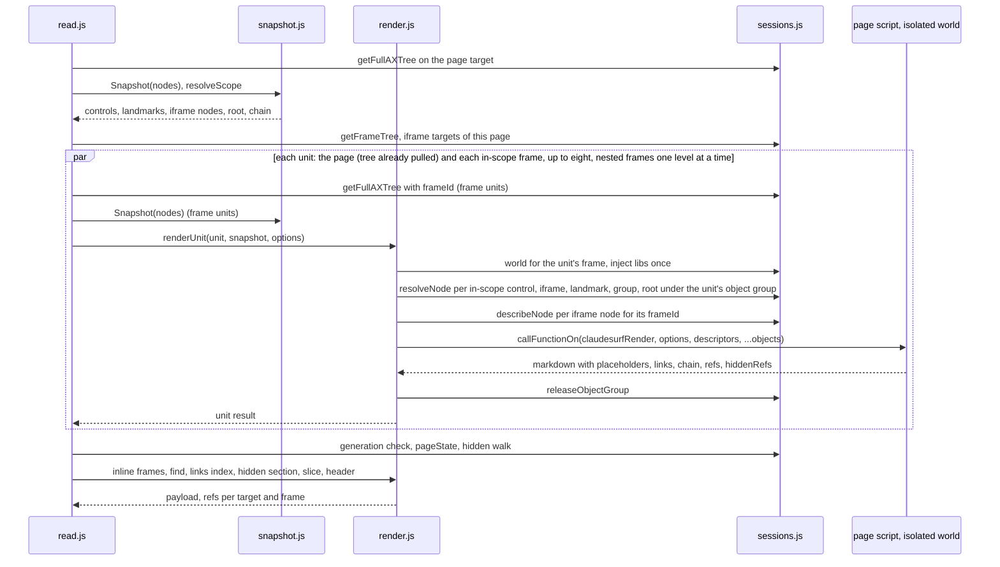

# Phase 2 — Structured reads (LLD)

## Goal

`page` returns interleaved markdown in place of `innerText` plus a flat element list: prose rendered by Turndown (or Readability then Turndown) in the isolated world, with every control placed inline as a ref-carrying marker whose role, name, and state come from Chrome's accessibility tree. Reads restrict to the main content by default and say what they omitted, follow same-process and out-of-process child frames, drop hidden content, deduplicate repeated links, and take `scope`, `find`, `article`, and `links` as parameters. `click`'s argument list and the `e<backendDOMNodeId>` ref scheme are unchanged except that a ref inside a cross-site frame gains an `f<n>` prefix; `since`, typing, and the rest of acting stay in later phases.

## Resolved decisions

> [!note]- **Context** — what these decisions close, and where the measurements come from
> Items 1–7 close the HLD's phase-2 open questions in order; 8–14 record choices the spike forced, and 15–19 are plan decisions. Question 5 also asked for the latency across several frame targets on a heavy feed; the spike measured one fixture iframe, so that half is bounded by the frame cap and the deadline degrade in decision 10 (frame attach) and measured at build time by the manual pass, as risk 11 (frame-heavy pages) records. The spike ran the phase-1 code against the installed Chrome 153, headless, over a fixture page with a cross-site iframe and over three live pages: a Wikipedia article (5,355 accessibility nodes), a GitHub repository page (4,965), and the Hacker News front page (1,624). Every figure below comes from that spike. The HLD statements this plan contradicts, and the two phase-3 open questions it adds, are corrected in the HLD in this LLD's commit; the Files entry for the HLD lists them. Every implementation, test, and doc change in Files and Tests belongs to one of decision 19's commits; the three design-doc entries marked as this LLD's commit are the exception. A file may span two commits where decision 19 names it in both: `sessions.js`, `daemon.js`, `input.js`, `dispatch.js`, `walk.js`, `README.md`, and the fake.

1. **The accessibility tree supplies control identity, landmarks, and frame nodes; the DOM supplies structure.** Headings, lists, tables, emphasis, and code come from Turndown over the DOM, so `generic`, `none`, `StaticText`, `InlineTextBox`, and `LayoutTable*` nodes are pruned by construction. A node counts as a control when its role is one of `button`, `link`, `textbox`, `searchbox`, `checkbox`, `radio`, `switch`, `combobox`, `listbox`, `option`, `menuitem`, `menuitemcheckbox`, `menuitemradio`, `tab`, `slider`, `spinbutton`, `treeitem`, `DisclosureTriangle`, `Date`, `DateTime`, `InputTime`, `ColorWell`, or when it carries an `editable` property (a `contenteditable` region Chrome reports as `generic`). These are Chrome's strings and the comparison is case-sensitive; the last five are Blink-internal and capitalized. The last five roles and the `editable` property keep the `<summary>`, date, datetime-local, time, color, and `contenteditable` controls phase 1's walk reached, so the capability set holds across the swap; `treeitem` is new. The spike confirmed a native `<select>` as `combobox` with `option` children (`listbox` under `multiple`), and that a date or time input exposes its picker button and its month, day, year, hour, and minute spinbuttons as controls of their own. A control nested inside another control's subtree therefore folds into its parent, unmarked, except `option`s under a `combobox` or `listbox`, which render as the parent's value list, twelve options at most and then `… and N more`: `[e5 combobox "Chooser" = "one" (options: one, two)]`. A `generic` container whose only accessible name is its own (`<div aria-label>`) renders as plain prose, with no marker of its own; a landmark's name appears in its boundary marker when the whole body renders, and a named `group` or `region` (a `fieldset` with a `legend`, a `<section aria-label>`) carries a boundary marker wherever it renders, since its name has no prose to survive in (decision 3.6, landmarks and groups). Focusable `generic` nodes stay out, as in phase 1's walk.

> [!example]- **Alternatives considered** — accessibility tree for prose too, prune-by-rule over the full tree, `DOMSnapshot` rendered in the daemon, tree text with DOM-ancestor markup, tree outline with DOM fragments (the tree for controls and landmarks, the DOM for structure) (decision 1)
> Render prose from `StaticText` nodes in tree order — one source, and it loses inline emphasis, code spans, and table columns, which the HLD's reads decision names as material on documentation. Walk the full tree and prune containers by a role list — has to answer which `generic` carries a name to keep, the question this decision avoids. Join `DOMSnapshot.captureSnapshot` to the tree by `backendNodeId` and render in the daemon with no page script — a pure function over two protocol messages, and it hand-rolls Turndown's job and drops Readability, so `article` and the Readability link of decision 2 go with it. Tree text order with each text node's DOM ancestors looked up for markup — the tree drops `role=presentation` and `aria-hidden` subtrees whose text is visible, so prose goes missing with no signal. The tree as semantic outline with sanitized DOM fragments attached where formatting matters — mapping text runs back to fragments is ambiguous and complex pages need most of the DOM anyway.

2. **`scope=main` resolves to the first `main` landmark, else an `article` node, else Readability's top candidate when `isProbablyReaderable` says so, else `body`.** The rules:
    1. **The chain**: the daemon decides the `main` and `article` links from the tree and otherwise hands the page script `auto`, which tries Readability during the render call and falls back to `body`, so the chain adds no round trip. Spike: Wikipedia and GitHub expose one `main`; Hacker News has no landmark and is not readerable, so it renders as `body`.
    2. **The `Scope:` header** names the link taken: `main`, `article`, `readability` (whichever path ran Readability, `article=true` included), `body` (the chain fell through), `all` (asked for), or the ref. `all` and `body` render the same subtree, and the word tells the agent whether it asked for the whole page or fell through to it. Only `main`, `all`, and a ref are inputs; the verb index says so.
    3. **The omission report**, on the same header line: every landmark outside the rendered subtree with its name, its ref, and counts of the controls omitted under it, so `scope=<ref>` expands one of them without a `scope=all` read first, plus the controls dropped from inside the subtree; the derivation is in Design (omissions). On the Readability link of a landmark-less page it reads `omitted: 214 links, 6 buttons elsewhere`.
    4. **`scope=all`** renders `body`; landmark boundary markers (decision 3.6, landmarks and groups) appear whenever the whole body renders, under `all` and under a fall-through to `body` alike, so a landmark-poor page still offers refs to narrow by.
    5. **`scope=e42`** renders that element's subtree in the unit its ref set entry names (decision 11, frame refs): `read.js` picks the unit from the ref's prefix and its `Map` entry, pulls that unit's tree, and runs `resolveScope` on it. An `<iframe>` element's ref renders that frame's unit alone, since the page tree stops at it. A ref inside a frame therefore renders that element's subtree within the frame's unit and nothing of the page's own prose. The page unit still pulls its tree for the omission report, whose root is then the `Iframe` node of the frame's top-level ancestor in the page, so every page control is outside it and grouped; the state lines stay the page's. The value is any ref a read returned, an `f`-ref included, resolved as `click` resolves it, so a frame nested inside a cross-site frame is reachable through the ref its marker carries. Two refs fail:
        1. A ref no read returned is `error`, as phase 1's decision 10 (generation and ref set) answers for `click`.
        2. A page ref absent from the current tree (removed or hidden since the read) returns `error` saying so.
    6. **`article=true`** runs Readability over the whole page document under `scope=main` or `scope=all` (decision 7, article fallback); combined with a ref scope it is a `schema_error` saying to drop one, since an article is a whole-document extraction.

> [!example]- **Alternatives considered** — Readability first, landmarks only, `body` with collapsed landmarks, size-triggered scope, salience budget, outline-first (landmarks, then `article`, then Readability, then `body`; omitted landmarks carry refs) (decision 2)
> Readability first with landmarks as fallback — on Wikipedia it drops the infobox and category links an agent wants, and its output is 5% shorter than the `main` subtree, so it buys little and decides too much. Landmarks only, no Readability in the chain — leaves a landmark-less article page (most blogs) rendering its header, sidebar, and footer, which is the overflow this phase exists to fix. Always render `body` and collapse each non-main landmark to a one-line summary with a ref — adopted in half: the refs and counts are in the omission line, and the collapsed-in-place rendering is not, since a page of landmark-less `div` clusters collapses nothing and the overflow returns on the pages the Readability link exists for. Render `all` and fall back to `main` only when the output exceeds a fraction of `max_chars` — the output's shape becomes a function of page size, so the agent cannot tell whether it saw the whole page. Fill the budget with the highest-salience blocks across regions — unpredictable, and it can drop the one low-prominence control the agent needs. An outline of regions with expandable refs as the default read — costs an extra call on every article read.

3. **One bracket vocabulary for everything the daemon adds to the prose, every field whitespace-collapsed, names and values capped at 100 characters.** The forms:
    1. **Links**: `[Talk](/wiki/Talk:Web_browser)[e1]`. A URL same-origin with the rendering unit's own document renders as its path, any other absolute, so a path inside a `[frame …]` block resolves against the frame's URL the marker shows. `title` attributes are dropped. A URL over 200 characters, or any `data:` URL, renders as `(url omitted: 1,240 chars)` in the URL position, since a cut URL is not navigable and the ref remains clickable. A link whose rendered text is empty (an icon-only link, a linked unnamed image) takes its accessible name as text, `[Sign in](/login)[e12]`, which is how phase 1 labelled it.
    2. **Repeated links** (decision 12, links): `[Dup link](…)[e5]`, the literal `…` standing for the URL of an earlier link with the same text and URL in the same unit.
    3. **Other controls**: `[e13 button "Search" (disabled)]`, `[e2 textbox "Email" = "foo@x"]`, `[e3 radio "One" (checked)]` — role, name, and state from the accessibility node, replacing the element's DOM text. The state words, in this order when present: `checked`, `mixed`, `selected`, `pressed`, `expanded` or `collapsed` (from `expanded`), `required`, `readonly`, `disabled`; a `slider` or `spinbutton` adds its range after the value, `= "50" (0–100)`.
    4. **Values**: rendered for `textbox`, `searchbox`, `combobox`, `spinbutton`, and `slider` only. The page script reads the value from the live node passed as an argument, cuts it to the cap with `…`, and renders `= "•••"` for a `type=password` field and for a field with `autocomplete=one-time-code`, whatever they hold, so a read after a `type` into a login form shows a mask in place of the secret.[^secrets] It reads the live node because a clone's `.value` is the element's default rather than what `type` entered, and the descriptor omits the value. The same mask applies in `walk.js`'s label chain, whose `value` fallback would otherwise print a hidden password field's value as its label in the `## Hidden elements` section; `state.js` carries the one definition of a masked field.
    5. **Images**: `[image "alt"]` without the `src`; an unnamed image is dropped; a linked image `[image "alt"](url)[e5]`.
    6. **Landmarks and groups**: landmarks whenever the whole body renders (`all`, or a fall-through to `body`), named groups and regions always: `[e12 navigation "Contents"]` … `[/navigation]`, `[e31 group "Shipping"]` … `[/group]`, the ref being the one the omission line would print, so a `scope=all` reader can narrow to a region it saw.
    7. **Frames**: `[e40 frame http://host/path cross-site]` … `[/frame]`, the ref being the `<iframe>` element's, so `scope=e40` reads that frame alone; the tag is present when the frame is its own target (decision 11, frame refs), since Chrome isolates by site and that is the boundary the prefix follows.

    The daemon caps names at 100 characters in `snapshot.js`. The page script applies the same cap to values and `alt`, leaves link text uncapped since it is the page's prose (whitespace collapsing alone fixes the Wikipedia case decision 12 cites), and collapses whitespace in all of them, so every marker but a long link is one bounded line, which decision 15 (paging) and decision 16 (`find`) rely on. The cap is phase 1's; it moves from a local in `walk.js` to `LABEL_MAX` in `action-support.js`, imported by `snapshot.js` and passed to both page scripts as an argument, so there is one copy.

[^secrets]: The HLD's secrets decision reduces typed text to a length and a hash in the action log; the mask is the read-side half of that.

> [!question]- **Anticipated questions** — can page text forge a marker or the delimiter?
> The untrusted delimiter has a different shape from every marker, so a marker cannot close it. Page text that prints `[e12 …]` is accepted as phase 1 accepted `[e12]`: a ref outside the set returns `error`, so a forged marker cannot be clicked, and Turndown's default escaping (Design, render) makes it arrive as `\[e12 …\]` in any case. The frame placeholder is `\u0000frame:<ref>\u0000`, and script-created text nodes can hold a NUL, so the page script strips NUL from text before Turndown runs; a page cannot move or duplicate a frame's content by reproducing the placeholder.

> [!example]- **Alternatives considered** — HTML-ish tags, Playwright's list form, markers after the text, private-scheme links, non-ASCII brackets, reference-style links only, a sidecar overlay (bracket markers with the ref first) (decision 3)
> `<button ref=e13>Search</button>` — unambiguous, and it hands the agent markup to parse inside markdown. Playwright's `- button "Search" [ref=e13]` — a list, so it cannot interleave with prose. `Search[e13]` with the role after — reads as prose until the ref, so a button and a word look alike until the end of the token. Every control as a link with a private scheme, `[Search](cs:e13?button&disabled)` — valid markdown everywhere, and it buries role and state in a query string the model has to parse to see that a button is disabled. `⟦e13 button "Search"⟧` — collision-free by construction, at a multi-byte token cost on every one of several hundred markers, and models mangle unfamiliar delimiters when echoing a ref into `click`. Reference-style `[websites][e1041]` always, with the index always present — standard markdown and 30% less output, and the agent chooses a link by its destination at the point of reading, which is then a page away; `links=index` keeps the form opt-in. Plain markdown plus a typed overlay mapping byte ranges to controls — separates prose from metadata, and a model correlates a sidecar with prose less reliably than an inline marker.

4. **The three libraries provide browser-global files; the daemon reads them unmodified from `node_modules` when it first needs them.** `@mozilla/readability` 0.6.0 (`Readability.js` → `Readability`, `Readability-readerable.js` → `isProbablyReaderable`), `turndown` 7.2.4 (`lib/turndown.browser.umd.js` → `TurndownService`), and `turndown-plugin-gfm` 1.0.2 (`dist/turndown-plugin-gfm.js` → `turndownPluginGfm`) each bind a global when `module` is undefined, which it is in an isolated world; none of the three packages has an `exports` map, so `require.resolve` on the subpath works. `action-support.js` resolves them on first use, concatenates them with `server/page/render.js`, and the result (122 KB) is evaluated once per isolated world (6–14 ms). Any failure to resolve or read one of them — a checkout without `server/node_modules`, or a release that adds an `exports` map and makes the subpath unresolvable — is a `SetupError` naming the file and `npm --prefix server ci`, which the daemon returns as `setup_error`. They become the package's first three runtime dependencies, pinned by `package-lock.json`, so `npm --prefix server outdated` starts reporting.

> [!example]- **Alternatives considered** — esbuild bundle, vendored copies, jsdom in the daemon, `addScriptToEvaluateOnNewDocument`, no dependencies, a renderer page (browser-global files read on first use, injected once per world) (decision 4)
> An esbuild step producing one minified injectable — a build step and a dev dependency for a 122 KB concatenation that already works. Vendoring the three files into `server/page/` — freezes them outside `npm outdated`, which the toolchain check exists to watch. Readability over jsdom in the daemon — rejected by the HLD (reads decision) for re-parsing markup the browser already parsed. `Page.addScriptToEvaluateOnNewDocument` into the `claudesurf` world — takes the injection off the read path and pre-arms a frame that navigates mid-read (risk 7, mid-read navigation), and evaluates 122 KB in every document of every target whether read or not; the per-world flag is one line. Hand-roll the DOM-to-markdown emitter and drop Readability — keeps the package dependency-free, and markdown conversion's value is in the edge cases (nested lists in cells, `pre` whitespace) and article extraction is not a heuristic this phase can write. Host the libraries in one daemon-owned renderer page and send it annotated fragments — target pages never run third-party code, and serialization loses live DOM properties and adds a target lifecycle.

5. **One `Accessibility.getFullAXTree` per frame, pulled in parallel, without `Accessibility.enable`.** A 5,355-node page answers in 139 ms with a 2 MB message. Narrowing by `depth` or `getChildAXNodes` is left to risk 1 (tree size) as the fallback.

> [!question]- **Anticipated questions** — is a 2 MB protocol message a problem for the pipe?
> No. `cdp.js` buffers NUL-delimited frames of any length, and phase 1's screenshot payloads are of the same order.

> [!example]- **Alternatives considered** — `queryAXTree` by role, a live tree mirror (one full pull per frame) (decision 5)
> `Accessibility.queryAXTree` filtered by role — scales with the control count instead of the node count, and it loses the tree order that decision 2's scope resolution (subtree membership) needs and replaces one command with seventeen per frame. `Accessibility.enable` plus a mirror maintained from `nodesUpdated` — makes later reads a delta, and the mirror is mutable daemon state that drifts with no way to notice, on an experimental event stream.

6. **A control's marker carries its accessible name, so its label text renders once, in the marker.** A `<label>` that wraps a control renders as the control's marker alone. A `<label for>` whose text equals the control's accessible name is dropped from the clone. A `fieldset`'s `legend` stays as prose inside the group's boundary marker (decision 3.6, landmarks and groups). Spike, before this rule: `Email[e1 input ""]Choices[e2 input ""]One`; after: `[e2 textbox "Email"]` and `Choices [e3 radio "One"] [e4 radio "Two"]`.

> [!example]- **Alternatives considered** — label as prose, name in the marker only when it differs (name in the marker, matching label dropped) (decision 6)
> Render the label as prose always and put the name in the marker only when it differs from the adjacent visible text — keeps a label's own markup and shortens form-heavy pages, and "differs" needs a normalization over whitespace, case, and truncation that will be wrong on some page, where the agent then loses the authoritative name silently.

7. **`article=true` on a page where Readability returns nothing falls back to the `scope` render** with a header line `Article: none found`; the `Scope:` line names what rendered instead. The default path reaches Readability only when the landmark chain has nothing (decision 2, scope chain), where a miss lands on `body` and the `Scope:` line says so.

> [!example]- **Alternatives considered** — strict projection (fallback to the scope render) (decision 7)
> Return `Article: none found` with no body — distinguishes failure from fallback content, which the header line already does, at the cost of a second call for the content the caller wanted.

8. **Prose is rendered from a clone the daemon's page script builds and annotates, because Turndown clones its input and Readability consumes it.** Turndown works on a private clone, and `Readability.parse()` strips and moves nodes in the document it is handed and returns its article as an HTML string (the spike saw the clone's body emptied while the live document stayed intact), so a `WeakSet` of control nodes is useless inside either library; a `data-cs-ref` attribute on the clone survives both (427 of 493 markers survived Readability on Wikipedia, the rest being outside the article). The Readability paths (`auto`, `article=true`) therefore build a whole-document clone, hand it to Readability, and on a miss render the fallback from the scoped clone, built separately and untouched; a Readability read pays both walks. That clone is `document.cloneNode(false)` with `<html>` cloned in by the same annotating walk, so `<head>` gives Readability the title, the byline, and a base for relative URLs. The annotating walk visits the scoped subtree in parallel with a shallow clone: it skips hidden elements by phase 1's `state.js` definition (`checkVisibility`, empty rect, `aria-hidden` ancestor), skips `script`, `style`, `template`, and `noscript`, sets `data-cs-ref="e<id>"` on control nodes, marks `<iframe>` elements for placeholder rendering, applies decision 6's label rule, and flattens open shadow roots: a host's clone receives the clone of its shadow tree in place of its light children, with each `<slot>` replaced by its assigned nodes, so a web-component page renders its painted content as phase 1's walk reached it (decision 11 there, shadow roots descended). A closed shadow root stays opaque, as it was to the walk. It costs 10–18 ms on the spike pages. Wikipedia's `main` renders at 156k characters without the visibility filter (hidden language menus) and 52k with it.

> [!example]- **Alternatives considered** — visibility from the tree, markers as text nodes in the clone (an annotated clone with `checkVisibility` and `data-cs-ref`) (decision 8)
> Treat a clone subtree as hidden when no `StaticText` node of the tree points into it — removes the per-element layout call, and the tree also prunes visible text in `role=presentation` and `aria-hidden` containers, so prose disappears with no signal where the current filter is auditable. Replace each control element in the clone with a text node carrying the finished marker — no Turndown rule for controls, and Turndown escapes `[` in text nodes, so every marker needs an escape override that then stops escaping the page's own brackets.

9. **The join runs from the tree into the DOM, under an object group per unit released when the unit ends.** The daemon takes from the tree the `backendDOMNodeId` of the scope-root node, of every control and iframe node inside the rendered subtree, and of every landmark and named-group node (a few dozen at most). It pipelines one `DOM.resolveNode` per node into the isolated world (493 nodes in 7 ms) under an object group named for the unit — `claudesurf-read-<n>`, `<n>` the unit's index within this read; `claudesurf-read-hidden` for the hidden walk — and passes the remote objects, plus a by-value descriptor array aligned with them (`ref`, `kind` ∈ `control | iframe | landmark | group | root`, `role`, `name`, `state`, `href`), as the arguments of one `Runtime.callFunctionOn`. The landmark nodes are always supplied, since on the `auto` path the page script decides whether a landmark marker renders. The omission report needs tree data only, so out-of-scope controls are never resolved; on the `auto` chain the rendered subtree is unknown until the page script decides, so the whole body's controls are resolved, which is the worst case risk 1 measures. `Runtime.releaseObjectGroup` runs in a `finally` per unit, as phase 1's read did, so a long-lived browser never pins nodes for a document's life; the per-unit name matters because the page and its same-process frames share one protocol session and run in parallel, and `releaseObjectGroup` takes only a name. `snapshot.js` decides once what counts as a control; the page script places markers where the descriptors say. Phase 1's walk survives only for decision 14 (hidden elements).

> [!example]- **Alternatives considered** — DOM-side classification joined by `describeNode`, attribute stamping on the live DOM, document-order indexing, `describeNode` intersected with the tree, `queryAXTree` per candidate (tree to DOM through `resolveNode`) (decision 9)
> Keep phase 1's walk as the classifier and join its handles to tree nodes through `DOM.describeNode` — two classifiers that disagree at the edges (a `role`-less focusable `div`, an `aria-hidden` link), and the walk's labels lose to Chrome's name computation. Stamp `data-cs-ref` onto the live elements — visible to page script and to `MutationObserver`s, which the isolated world exists to avoid. Resolve only the scope root and let the page script number controls in document order for the daemon to align descriptors to — one `resolveNode` per frame, and tree order diverges from DOM order under `aria-owns`, CSS `order`, and portals, where one divergence shifts every following ref into a silent wrong click. Phase 1's stash-and-`describeNode` conversion intersected with the tree's control set — reuses a measured mechanism and keeps the tree as sole classifier, and it describes every candidate to keep a few hundred, scaling with the page rather than its controls. Discover DOM candidates and `Accessibility.queryAXTree` each — the descriptor arrives with its object, and candidate discovery is a second classifier again.

10. **Out-of-process iframes attach through a per-page `Target.setAutoAttach` sent to every page and iframe target when it attaches; the registry records them, and a read renders the frames inside its scope as units.** The browser-level auto-attach phase 1 sends surfaces page targets only; its `iframe` filter entry is inert at browser level, as phase 1's Design noted, and stays as it is. The per-page call is `{ autoAttach: true, waitForDebuggerOnStart: true, flatten: true, filter: [{ type: 'iframe' }] }`, so workers never reach the non-page attach branch. It is queued with `Page.enable` ahead of the `runIfWaitingForDebugger` release, for the reason phase 1's attach handler gives: a command awaited before the release deadlocks on a paused noopener tab. Four spike facts carry the design:
    1. The per-page call surfaces the frames.
    2. An iframe target's id equals the `frameId` that `DOM.describeNode` reports for its `<iframe>` element.
    3. A same-process child frame answers `Accessibility.getFullAXTree({frameId})` and `Page.createIsolatedWorld({frameId})` on its parent's protocol session.
    4. A parent's tree stops at its `Iframe` node (no children) for both frame kinds, so a unit's tree holds its own frame's nodes only.

    The rules:
    1. **Discovery**: a read lists frames from `Page.getFrameTree`, sends one `DOM.describeNode` per `Iframe` tree node inside the rendered scope (by `subtree` membership; every iframe under `scope=all`) alongside the resolve burst to learn the node's `frameId`, joins node to frame on it, and renders each such frame as its own unit — tree, world, injection, render — whose output replaces the placeholder at the iframe's position inside `[frame …]` markers. An iframe outside the scope is neither rendered nor pulled and does not count against the cap; its controls are unknown, so the omission line lists it by ref under `frames not read`. A hidden iframe is neither rendered nor counted, like any hidden element.
    2. **Unit rendering**: a frame whose placeholder the render did not emit — Readability dropped the `<iframe>` — has its unit output discarded and counts as a frame not read. A frame unit inlined inside another unit's render is capped at 8,000 characters, and all inlined frames together at 16,000 per read, each cut at a newline with a closing line `(frame content cut: N more characters; scope=e40 reads it whole)`, so embeds above the fold cannot displace the page's own content the way phase 1's decision 23 (elements last) guarded against. A frame that is the scope root is bounded by `max_chars` alone, like any region. Landmark markers inside a frame appear when the page's own render carries them. A frame's links join a `links=index` list. `article` applies to the page only.
    3. **Records**: an iframe target record has the page record's shape (`url`, `generation`, `world`, `mainFrameId`, the load, navigation, download, and same-document counters, `waiters`, `dialogs`), so phase 1's handlers — `dropAll`'s `failWaiters`, the counters, `onFrameNavigated`'s `url` — run on it unchanged. It adds `type: 'iframe'`, a frame number (decision 11, frame refs) from the root page target's counter, and `parentTargetId`: the target whose protocol session delivered the `attachedToTarget` event, which under `flatten` is the parent's, so `frameTargets` follows the chain through nested frames without a frame-tree call. `Page.enable` runs on iframe targets so their own `frameNavigated` bumps their generation, and `type` is how the acting phase's settle detection and `tabs list` tell them from pages; the frame is recognized as the target's own by `frameId === targetId` (the observation risk 6 flags), since it carries a `parentId` that phase 1's handler treats as a child frame.
    4. **Dialogs**: `Page.enable` also routes a frame's `javascriptDialogOpening` to `onDialog`, which dismisses it and queues the note on the iframe record; `daemon.js` drains `takeDialogs` over the working target and its frame targets (`frameTargets`), so a dialog raised inside a frame reaches the agent as one raised by the page does.
    5. **Focus emulation** is not sent to them: it lifts an input stall, and this phase sends frames scripted clicks only, which do not stall (trusted clicks are refused). The acting phase, when it routes `type` and `press` into frames, has to send it to iframe targets too or meet the five-second stall phase 1's decision 19 (focus emulation) documents; the HLD's phase-3 open questions carry this.
    6. **Failure**: a frame the read cannot render (no attached target yet, `about:blank`, a pull that fails, a unit that misses its 5 s budget) renders `[e40 frame url (not readable)]`; the read never fails for a frame.
    7. **Cap**: at most eight frame units render per read, in document order, the page unit not among them; the rest render `[e40 frame url (not read: frame limit)]`. Frame content past the cap, or in a frame that rendered `(not readable)`, or cut by the per-unit cap in rule 2, is read whole with `scope=<the iframe's ref>`, which every frame marker carries.
    8. **Gate**: every attached iframe target is a `Page.enable`d target that can navigate; the acting phase's domain gate, designed against page targets, has to decide whether it intercepts frame navigations too or names them as ungated; the HLD's phase-3 open questions carry this.

> [!example]- **Alternatives considered** — disable site isolation, frames on demand (per-page auto-attach, frames rendered inline) (decision 10)
> Launch with `--disable-features=IsolateOrigins,site-per-process` so every frame shares the page's renderer — the whole out-of-process apparatus disappears, and so does the browser's security boundary inside a profile signed into the human's accounts, which is the containment the dedicated profile exists for. Render each frame as a one-line placeholder and pull it only on `scope=f1` — four ad frames cost four lines, and the embedded login, payment form, and challenge the HLD names as the motivating cases need a second round trip the agent has to know to make; a frame pull is milliseconds.

11. **A ref carries the prefix of the target it was read in: `e<id>` for the page target, `f<n>e<id>` for an iframe target.** A same-process frame's refs take the prefix of the target whose renderer it shares — bare when that is the page, `f<n>` when it is a cross-site frame with a same-site child — so a bare id is unique within the page target's set and a prefixed one within its frame target's. The rules:
    1. **Numbering**: `<n>` is assigned to the iframe target when the registry records it, from a counter on its root page target that never reassigns a number for that target's life. A ref from an earlier read of the same generation therefore still names the same frame after an ad frame attaches late, and numbers stay small and session-local. The root page target is found by following `parentTargetId` (decision 10.3, records); the same walk gives a destroyed iframe target the session whose ref-set entry `onDestroyed` drops.
    2. **Grammar**: `refFormat` widens to `^(f\d+)?e\d+$`.
    3. **The set**: the ref set's `ids` becomes a `Map<id, frameId | null>` recording which frame of the target each id was read in, so `click` and `scope=<ref>` resolve a same-process frame's node in that frame's isolated world (`DOM.resolveNode` takes the world's context id, and a node resolves only in its own frame's world); a node of the target's own main frame records `null`.
    4. **Resolution**: `click` parses the prefix, finds the target by its frame number under the working target, and resolves the ref against that target's set and generation and the recorded frame's world; a scripted click there runs as on the page.
    5. **Staleness**, in phase 1's vocabulary (decision 10 there, generation and ref set):
        1. A frame number that was assigned and whose target is gone — the parent navigated and Chrome destroyed the frame targets, or the frame itself was removed — returns `stale_ref` saying the frame is gone.
        2. A frame number never assigned (at or past the page target's counter) returns `error`, as a ref never read does.
        3. A frame target whose generation moved returns `stale_ref` saying the frame's document changed.
        4. A ref never read in that frame returns `error`.
    6. **Trusted clicks**: a trusted click on an `f`-ref returns `error` saying trusted clicks inside cross-site frames are not supported yet and a scripted click is; the coordinate offset through the parent's iframe box lands with the rest of input in the acting phase.
    7. **Same-process frames**: this refines the HLD's ref decision and requirement 17 (a ref scoped to its frame target and generation). A same-process frame's refs are scoped to its target and that target's generation, so a same-process frame that navigates on its own leaves its refs in the set, and a click on one then fails to resolve and returns `error` saying the element was removed. That rests on Blink never reusing a `backendDOMNodeId` within a renderer's life (ids are allocated from a counter), the same property phase 1's removed-element `error` path already relies on; the prefix covers the HLD's cross-target case (a bare id resolving in another renderer).

> [!example]- **Alternatives considered** — search every set for a bare id, a per-read frame index, opaque tokens, trusted frame clicks now (frame numbers stable per target, trusted deferred) (decision 11)
> Render every ref as `e<id>` and search the page's and its frames' sets on click — `backendDOMNodeId` is unique per renderer, so two cross-site frames can hold the same id, and the click would pick one silently. Number frames per read — legible, and a late-attaching frame renumbers the rest, so an `f2e42` from the previous read can resolve against another frame's node: the silent wrong click the prefix exists to prevent, and a breach of the phase-1 promise that refs stay valid across reads of one generation. Replace every ref with a short opaque token mapped to target, generation, and id — one syntax everywhere, and it breaks the `e<id>` contract for a problem stable numbering fixes. Build the trusted path for frames in this phase — about twenty lines (`DOM.getBoxModel` on the iframe element plus the child's quads), and it belongs with the input work that also has to route `type` and `press` into frames.

12. **Links render inline with path-shortened URLs by default, and a repeated link drops its URL.** `links=inline` (default) renders decision 3's form; `links=index` renders `[Talk][e1]` in the prose and a trailing `## Links` section, a plain list keyed by ref with one line per distinct absolute URL carrying every ref that points at it, `[e1, e5] /wiki/Talk:Web_browser`, merged across the page and its frames on the absolute URL and printed absolute in the index, so a frame's `/login` and the page's `/login` stay two distinguishable lines. A repeated (text, URL) pair renders `[Dup link](…)[e5]` on its second and later occurrences — still clickable, with the URL shown once (HLD requirement 20, deduplicated links); the inline dedup is per unit, since each frame's page script keeps its own state, so a pair repeated across a frame boundary shows its URL in both. Link content has its whitespace collapsed, since Wikipedia's table of contents rendered as `[\n\n(Top)\n\n](#)`. URLs are 30% of Wikipedia's rendered output; `links=index` exists for that.

> [!question]- **Anticipated questions** — is `[Talk][e1]` a CommonMark reference?
> No. The index is a plain list keyed by ref, and a markdown renderer shows the prose brackets literally. The agent reads the raw text, where the bracketed ref is the point.

> [!example]- **Alternatives considered** — no URLs by default, CommonMark reference definitions (inline URLs, path-shortened, repeats elided) (decision 12)
> Drop URLs from the default render and serve them through `links=index` — the ref is what `click` consumes, and the agent routinely picks a link by destination or prefers `navigate` to `click`, both needing the URL where it reads. URL-level reference definitions with click refs kept distinct — every URL once regardless of text, and two adjacent identities per link confuse the reader.

13. **A table whose first row is `th` cells renders as a GFM table; any other table renders one line per row with cells space-joined.** A cell keeps the newlines of its own content, so a nested table or a paragraph inside a layout cell contributes its own lines and a page built on an outer layout table (Hacker News) renders as many lines, not one. The GFM form comes from `turndown-plugin-gfm`'s `tables` rule; the plugin's rules are taken one by one rather than as its `gfm` bundle, whose `tables` rule keeps a header-less table as raw HTML, which is how Hacker News came out of the spike.

> [!example]- **Alternatives considered** — layout tables as GFM with a blank header, schema-and-row records (GFM for header tables, rows for the rest) (decision 13)
> Layout tables as GFM with a synthesized empty header — one table syntax, and it presents scaffolding as data whose columns the page never asserted. A compact schema-and-row record format — keeps spans and multi-level headers, and it is a custom format less readable than markdown.

14. **The default read reports the hidden-control count in a header line, and `hidden=true` appends a `## Hidden elements` section in phase 1's list form.** Chrome prunes most hidden controls from the tree as `ignored` nodes, which lack both role and name, so the hidden list cannot come from the tree; the page script reports a control the tree keeps but `state.js` rejects (zero opacity, an empty rect) as hidden, and the omission line leaves it out. Both the count and the section come from phase 1's `walk.js` restricted to hidden elements, run over the page target's whole document regardless of `scope` and never inside a frame, which is what the number means; the walk's ARIA role list widens to decision 1's (`treeitem`, `slider`, `spinbutton`, `listbox`, `searchbox`, `menuitemcheckbox`, `menuitemradio` added; the native date, time, and color inputs its `input` selector already reaches), so a hidden control the visible read would have listed is counted and listed here. The count costs the walk alone (11 ms for a thousand elements in phase 1's spike) and prints as `Hidden: 4 controls on the page (hidden=true lists them)`, omitted at zero; the section resolves ids as phase 1 resolved them and merges them into the page target's ref set. Two hidden populations therefore differ in when they become clickable: a control the tree kept but `state.js` rejects is in the ref set from any read of its unit (decision 15, the ref set), while one Chrome pruned from the tree — `display:none`, `aria-hidden` — enters the set only through a `hidden=true` read, by a scripted click as phase 1's decision 11 (hidden and disabled elements) allows. The section sits at the end of the region, so `slice` can cut it. Every read skips hidden prose, since the annotating walk drops hidden elements; `hidden=true` adds the control list alone. This keeps HLD requirement 18 (skipped count reported) met.

> [!example]- **Alternatives considered** — hidden controls inline, an affordance graph (a trailing list from the walk) (decision 14)
> Render hidden controls inline with a `(hidden)` state from the clone walk and delete `walk.js` — position is a hidden control's value, and it puts the walk's classifier and label chain into the prose path beside the tree's, where the two would disagree on the same page; a trailing list keeps the weaker source visibly apart. An affordance graph connecting triggers to the dialogs, menus, and regions they reveal — tells the agent how hidden content becomes visible, and most sites encode that only in script; recorded in `future-claudesurf.md`.

15. **Everything after the header is one region; a cut snaps back to the last newline, and a line longer than the budget is cut at a code-point boundary.** Markers never contain a newline (decision 3, collapsed fields), so a newline cut never splits a ref, and phase 1's two-region body/elements logic is removed. When the last newline before the cut lies at or before `offset` — one paragraph or `pre` block longer than `max_chars` — the cut lands at `max_chars` stepped back off a surrogate pair, as phase 1's body cut did, so a response is never empty and `offset` always advances; that cut can split a marker, and the ref stays in the set and clickable, as phase 1 made a feature of refs cut by `max_chars`. The truncation line reports the end used: `[Showing characters 0–39987 of 91234. Pass offset=39987 for the next part.]`. Offsets index a payload built fresh per call, so on a page that mutates between calls a continuation, or a `[offset N]` from `find`, can land off by the change, as phase 1's decision 23 (paging) conceded. Every control, landmark, and iframe node in the tree of a rendered unit joins its target's ref set, whether its marker was delivered, cut, dropped by Readability, or skipped as hidden, so anything the tree found is clickable by a scripted click, as phase 1 (decision 10 there, generation and ref set) made every walked id clickable.

> [!example]- **Alternatives considered** — a retained render, block-boundary cuts, AST cursors (one region, newline cuts, fresh per call) (decision 15)
> Retain the rendered payload per target and page from it — continuations stop re-paying the pipeline and offsets stabilize on a mutating page, and it is the prior-snapshot store the HLD placed in the acting phase, with the cap and invalidation that come with it. Snap to a blank line and never split a table or fence — a block larger than `max_chars` then needs a character-cut escape hatch anyway, so two behaviors instead of one. Page a block AST with opaque cursors and mint refs only for delivered blocks — semantic chunk ends, and cursor state complicates retries and a ref cut by `max_chars` stops being clickable, which phase 1 made a feature.

16. **`find` is a case-insensitive substring match over the scoped render, frames included and the `## Links` index excluded, returning each matching block.** Blocks are blank-line delimited. Each is prefixed with `[offset N]`, the block's offset in the full render, for a follow-up call without `find`. `max_chars` bounds the matched blocks as their own region, and `offset` together with `find` is a `schema_error`, since the two offset spaces would otherwise be confused. A truncated `find` ends its truncation line `Narrow find, or read without it from offset 12040.` in place of the `Pass offset=` clause, the number being the last delivered block's `[offset N]`. A `Find:` header line counts blocks: `Find: "market share" — 3 blocks`; with zero matches the region is empty, the truncation line is omitted, and the header says `0 blocks`. A `find` read omits the `## Hidden elements` section, since it is not a block of the page, and under `links=index` its `## Links` lists the URLs of the refs in the matched blocks only; the `Hidden:` count line still prints. The search covers what the `scope` rendered, so a match in an omitted landmark needs `scope=all`; the verb index says so. A needle spanning a character Turndown escaped misses, which is accepted. On a page built as one layout table (Hacker News) the rows form one block, so a match returns the listing cut by `max_chars`; the row form keeps that readable.

> [!example]- **Alternatives considered** — a control locator, elided full render, search over source text (substring over rendered blocks) (decision 16)
> Match control names and link text only and return refs with one line of context — ten tokens for the dominant use, and the agent also searches prose: a price, an error message, a version. Return the whole render with non-matching regions elided — keeps heading context, and it is more output on a parameter whose purpose is less. Search the DOM text before conversion and return the smallest semantic ancestor — markdown punctuation cannot split a phrase, and results then differ from the text the agent sees and need an offset mapping.

17. **`since` is deferred to the acting phase.** The prior-snapshot store and `diff.js` land with settle detection, where the HLD's phase-3 entry and its data model place them.

> [!example]- **Alternatives considered** — `since` on a retained render now, a mutation journal (deferred) (decision 17)
> Ship `since` here on the retained render decision 15 rejected — diffing rendered markdown is a string operation, and without settle detection the diff is taken against a page mid-load and reports skeleton churn as change. A `MutationObserver` journal installed at the first read — reports the causal regions instead of two renders' difference, and it misses accessibility, layout, and property changes and overflows on a busy page.

18. **`server/package.json` goes to 2.1.0.** The read output changes shape and the package gains its first dependencies.

19. **The phase lands as six commits on the branch, reviewed together, and the tool stays usable after each:**
    1. **2.1 frame targets** — `sessions.js` records iframe targets with their frame numbers, sends the per-page auto-attach, drains their dialogs, and gains `world(targetId, frameId)` and `withWorld`, with its tests; `browser.js`'s comment; nothing reads the frames yet.
    2. **2.2 the tree** — `snapshot.js` with its recorded-tree tests, the fake's tree and `resolveNode` answers, the dependencies and the version bump, `CLAUDE.md`'s dependency line, the Setup lines of `capabilities.md` and `worktree.md`, and the README's setup and migration lines; nothing calls it yet.
    3. **2.3 the renderer** — `page/render.js`, `page/state.js`'s mask, `action-support.js`'s `renderSource` and `LABEL_MAX`, `walk.js`'s arguments, and a live test that injects the source over the fixtures and calls `claudesurfRender` directly; `read.js` untouched.
    4. **2.4 the structured read** — `render.js`, `read.js` rewired, the fake's render answer, the ref set's `Map` in `sessions.js` and `input.js`, `hidden` and paging on the new output, `daemon.js` passing the new arguments through; every `<iframe>` renders as `[e40 frame url (not readable)]`; `find`, `scope`, `article`, and `links` run at their defaults, since `dispatch.js` does not yet accept them; the unit and live tests for the default read.
    5. **2.5 frames** — frame units rendered inline, `f`-refs produced and resolved in `input.js`, `refFormat` widened in `dispatch.js` so the bridge and daemon accept them, the trusted refusal, with their tests and fixtures.
    6. **2.6 the parameters and the docs** — the four parameters exposed in `dispatch.js` with its tests, the `daemon.test.js` and live cases that pass them, the rest of the README, and the rest of the context docs.

> [!example]- **Alternatives considered** — frames inside the read commit, tree and renderer in one commit, renderer and read rewire in one commit, an environment-switch fallback, shadow mode (frames, the tree, and the renderer as their own commits, hard cut) (decision 19)
> Land the tree module with the renderer — one fewer commit, and the renderer commit then carries three new modules, the first dependencies, and both suites, the same weight objection as frames. Land the in-browser renderer with the daemon-side assembly and the `read.js` rewire — one fewer commit, and that commit carries the marker vocabulary, the clone walk, the Turndown rules, assembly, paging, and the ref-set change at once; the renderer tests cleanly on its own through a direct call over the fixtures. Land frames inside the read commit — one fewer commit, and it puts the phase's one observed-not-documented behavior (risk 6, `frameId === targetId`), its new ref grammar, and its new target type in the same diff as the read rewrite they contribute nothing to. Ship the new read behind an environment switch that falls back to the flat read — a bad interaction on a real page is recoverable without a revert, and two read paths double every assertion and the old one never dies, which phase 1 refused for the extension. Run the new renderer in shadow beside the old one and compare — live parity evidence, at double extraction cost and no visible progress until the cutover.

## Design

A read becomes a pipeline over frame units. A unit is one document the daemon can pull a tree from and run script in: the page's main frame, a same-process child frame (page target, child `frameId`), or an out-of-process child frame (its own iframe target). `read.js` orchestrates; `snapshot.js` owns the tree, `render.js` the daemon side of rendering and assembly, `server/page/render.js` the in-browser side.



**Snapshot.** `snapshot.js` turns one `getFullAXTree` result into a `Snapshot`: the node map, the controls (decision 1, control roles) with `href` from the `url` property and state from `checked` (`true`, `false`, or `mixed`), `disabled`, `expanded`, `selected`, `pressed`, `required`, `readonly`, and `valuemin`/`valuemax` for the range (the value is the page script's; decision 3.4, values), the landmarks, the named groups, the `Iframe` nodes, the root's name, and `subtree(nodeId)` for membership tests. `resolveScope(snapshot, scope)` applies the tree-decided links of decision 2's chain and returns `{ rootBackendId, chain }`: the root's `backendDOMNodeId` (null for the body) and the chain link (`main`, `article`, `ref`, `all`), or `auto` when the page script is to try Readability and fall back to `body`; the page script reports the link it took, and the `Scope:` header prints that word, or the ref itself for `ref`. `node(backendId)` looks any tree node up, which `scope=e42` needs for an arbitrary element and `omissions` needs for landmark containment. All three are pure over protocol data and ref lists, so they can be tested without a browser.

**Omissions.** `omissions(snapshot, root, renderedRefs, hiddenRefs, unreadFrames)` derives the `Scope:` line's report by difference: an omitted control is one the tree holds, the render emitted no marker for, and the page script did not report as hidden. `root` is a node id of the page snapshot, or the sentinel `body`. The page script checks every node it was handed against `state.js`, so the controls it reports as hidden are the ones the walk's `Hidden:` count covers approximately (risk 13, hidden-content residue). Out-of-scope controls are never resolved (decision 9, the join), so a tree-kept-but-invisible control in an omitted landmark — a closed dropdown's items — counts in that landmark's omitted total; the counts say what a `scope=<ref>` read would find in the tree, not what it would render, and risk 13 carries this. Grouping depends on what rendered:
1. **A tree root** (`main`, `article`, a ref): a control outside the root's subtree is grouped under the top-most landmark that contains it — every top-level landmark outside the subtree is listed with its name and ref and with counts of `links`, `buttons`, and `other controls` when non-zero, a landmark nested in a listed one folds into its parent's counts, and controls under no landmark are summed as `elsewhere`; a control inside the subtree that Readability dropped or the clone walk skipped is summed as `dropped inside: N links, M buttons`.
2. **`readability`** (an `auto` chain, or `article=true`): the article is not a tree subtree, so containment cannot be computed against it; every omitted control is grouped under its top-most landmark as in rule 1 (a `main`-less blog still has its `banner`, `navigation`, and `contentinfo` to expand by ref) and the rest summed as `elsewhere`, with nothing under `dropped inside`.
3. **`body` or `all`**: everything rendered, so only hidden controls are left and the report is empty.

The report covers the page unit; a frame unit's dropped controls are left uncounted, accepted with risk 13 (hidden-content residue). Past twelve landmarks the line ends `… and N more (scope=all)`; iframes outside the scope add `frames not read: [e40], [e41]`, refs included so one expands without a `scope=all` read; frames capped or `(not readable)` are already visible inline and are not counted there.

**Frame discovery.** `Page.getFrameTree` on the page target lists every child frame with its id; the registry's iframe targets (decision 10, frame attach) are matched by `targetId === frameId`; any child frame without a target is a same-process frame on the page's session. Nested frames recurse one level at a time: a unit's `Iframe` nodes are joined to frames of its own tree, so a frame in a frame renders inside its parent's placeholder, and the eight-frame-unit cap counts frames at every level. Each unit's world is cached in the registry per (target, frameId, generation) — `Sessions.world(targetId, frameId)` generalizes phase 1's per-target world — and the injected-libraries flag rides on the world record, so a second read of the same document skips the 122 KB. A same-process frame that navigates on its own leaves the page's generation and this cache untouched; the next call into its world reports the context missing. Phase 1's one retry lives in `callInWorld`, which neither the resolve burst nor the ref resolution uses, so `sessions.js` gains `withWorld(targetId, frameId, fn, opts)`, which hands `fn` the context id and retries it once on a missing-context error with a recreated, un-injected world; `renderUnit` and `resolveRef` run inside it.

**Render.** The daemon resolves the unit's control, iframe, landmark, group, and scope-root nodes into the world (decision 9, the join) and calls `claudesurfRender(options, descriptors, ...nodes)`. The page script builds the annotated clone (decision 8, the clone), then either hands it to Readability (the `article` path, or the `auto` chain when `isProbablyReaderable` holds, over a whole-document clone) or straight to Turndown. Turndown is configured with ATX headings, fenced code, `-` bullets, `turndown-plugin-gfm`'s `strikethrough`, `taskListItems`, `highlightedCodeBlock`, and `tables`, plus the daemon's rules added before the plugin's: control markers from the descriptor (decision 3, marker vocabulary), `[image "alt"]`, the layout-table rows (decision 13, tables), link whitespace collapsing, link deduplication and the `links=index` form, landmark boundaries when the whole body renders, and a `\u0000frame:<ref>\u0000` placeholder for each iframe element. Turndown's default escaping stays on, so page text that looks like a marker arrives as `\[e12 …\]` and a forged marker is distinguishable; a `find` needle spanning an escaped character misses, which decision 16 (`find`) accepts. The script returns `{ url, title, markdown, links, chain, refs, hiddenRefs, article }`, where `refs` lists every ref it emitted and `hiddenRefs` every control it skipped for visibility, so the daemon can compute omissions without double-counting a hidden control.

**Assembly.** `render.js` replaces each placeholder with the child unit's output between `[e<id> frame url cross-site?]` and `[/frame]`, runs `find` (decision 16, matching blocks) over the region before the index is appended, appends the `## Links` section when asked, appends the `## Hidden elements` section at the end of the region (decision 14, hidden elements) — the hidden section omitted and the index narrowed to the matched blocks under `find` — and slices the region (decision 15, paging). The index sits inside the sliced region, at its end, since an index of several hundred lines outside the budget would defeat `max_chars`; on a page longer than the budget the agent pages to it, as it pages to the hidden section. Header lines precede the region and are never cut, so `max_chars` bounds the region alone and a small budget still returns the whole header, which a twelve-landmark `Scope:` line can run past a kilobyte. The lines, in order:
1. The state lines.
2. The truncation line, when anything was cut.
3. `Scope: main (omitted: banner [e11], navigation "Site" [e12] 6 links, navigation "Contents" [e30] 41 links, search [e20] 1 other control, contentinfo [e43] 9 links; scope=e12 expands one, scope=all everything)`.
4. `Hidden: 4 controls on the page (hidden=true lists them)`, when the count is non-zero.
5. `Links: 312 (index at offset 48200)` under `links=index`, so the agent pages to it in one hop.
6. `Find: "market share" — 3 blocks` under `find`.
7. `Article: "<title>" by <byline>` or `Article: none found` under `article=true`.

Every control, landmark, and iframe node in each rendered unit's snapshot joins the ref set of the target it came from (decision 15, paging and the ref set), so `scope=<ref>` on an omitted landmark and a click on a control Readability dropped both resolve. The `URL:` and `Title:` lines come from `pageState` on the page target, as `info` takes them, so they name the tab whatever unit rendered.

**Click.** `input.js` parses `f<n>e<id>`, finds the iframe target carrying frame number `n` in the registry, and resolves the id against that target's set and generation, in the world of the frame the set recorded for the id, with decision 11's staleness mapping. The click script runs on the frame target's protocol session and the `finally` releases the object group there; the navigation wait and the `URL:`/`Title:` state lines stay the page target's, so a navigation confined to the frame reads as `Navigated: no` while the frame's own generation bump makes its refs stale. The trusted path refuses an `f`-ref. A bare `e<id>` resolves against the page target, in the page's world or a same-process frame's world as the set's `Map` says.

**Daemon plumbing.** `daemon.js`'s handler table passes `scope`, `find`, `article`, and `links` through to `readPage`; nothing else there changes.

**Non-HTML documents.** A JSON or plain-text response is a document whose body holds one `<pre>`, so it renders as a fenced block with no controls; Chrome's PDF viewer is a document whose tree holds an embed and whose body has no text, so the region reads `(no readable text; use screenshot)`. Neither reaches risk 12's error.

**Mid-read navigation.** `readPage` records the page target's generation before the pull and checks it after the render, as phase 1 did, and returns `error` saying the document changed when it moved, so the read discards a render that `withWorld`'s retry produced against a new document; a frame unit whose target's generation moved mid-read renders `(not readable)` (risk 7, mid-read navigation).

**Time budget.** Frame units run in parallel under the request deadline, at most eight per read, with nesting levels serialized (a level's iframe nodes are known only after its render), so the worst case is one 5 s budget per level; nesting stops at three levels, and the rest render `(not read: frame limit)`. A frame unit gets its own budget of 5 s, or what remains of the request deadline minus a 2 s margin if less, and degrades to `(not readable)` when it runs out, so one stalled embed costs the read five seconds rather than the whole budget; the page's own output is delivered regardless. The page unit has no degrade: its tree pull, resolve burst, or render failing or timing out fails the read with `error`, as any handler's protocol failure does. Measured per read on the spike pages: tree pull 38–147 ms, injection 6–14 ms (first read of a document only), resolve 4–61 ms, render call 26–124 ms, hidden walk about 11 ms. A first read of the heaviest spike page stays under 400 ms; the budget that matters remains cold start, unchanged from phase 1. Each unit logs its node count and its pull, resolve, and render timings at debug; a frame degrade, the frame cap, and a renderer exception log at info, since none of the three is visible in the payload.[^diag]

[^diag]: The HLD's diagnostics concern asks for this: protocol commands and errors at debug, lifecycle and gate decisions at info.

## API / Schema

### MCP tool: `claudesurf_read`

`page` gains `scope`, `find`, `article`, `links`; `hidden`, `max_chars`, `offset` stay. `info` and `screenshot` are unchanged.

| Action | Arguments (**bold** = required) |
|---|---|
| `page` | `scope` (string, default `main`: `main`, `all`, or a ref like `e42` or `f1e12`), `find` (string), `article` (boolean, default false), `links` (`inline`/`index`, default `inline`), `hidden` (boolean, default false), `max_chars` (integer, default 40000), `offset` (integer, default 0) |

The verb index entry becomes: `page`(scope, find, article, links, hidden, max_chars, offset) — the page as markdown with controls inline as refs like [e42] or [e42 button "Save"] for claudesurf_act; main content by default (scope=all for the whole page, scope=e42 for one element's or frame's subtree; the Scope: line names what rendered, which is not always a value you can pass), find=text returns the blocks matching it within that scope, article=true extracts the article, links=index moves URLs to a trailing list.

`click`'s `ref` accepts `^(f\d+)?e\d+$`; its description adds that an `f`-prefixed ref is inside a cross-site frame and clicks by script only. The `page` entry roughly doubles and four properties join the shared schema, about 120 tokens on the HLD's ~600-token two-tool budget, well under the 2,500 of one tool per action.

### Payload: `page`

Header lines, then a blank line, then the region:

```
URL: https://en.wikipedia.org/wiki/Web_browser
Title: Web browser - Wikipedia
[Showing characters 0–39987 of 52636. Pass offset=39987 for the next part.]
Scope: main (omitted: banner [e11], navigation "Site" [e12] 6 links, navigation "Contents" [e30] 41 links, search [e20] 1 other control, contentinfo [e43] 9 links; scope=e12 expands one, scope=all everything)
Hidden: 145 controls on the page (hidden=true lists them)

# Web browser

A **web browser**, often shortened to browser, is an application for accessing [websites](/wiki/Website)[e1041]. …

| Key | Value |
| --- | --- |
| alpha | 1 |

[e2 textbox "Email"] [e29 button "Generic wrapped"]
Choices [e3 radio "One" (checked)] [e4 radio "Two"]

[e40 frame http://127.0.0.2:35453/labels.html cross-site]
# Labels
[f1e12 button "From aria-label"] …
[/frame]
```

Under `links=index` the prose reads `[websites][e1041]` and the region ends with `## Links` and one `[e1041] /wiki/Website` line per distinct URL, every ref pointing at it listed. Under `find=market share` the header carries the state lines and the `Scope:` line as always, then:

```
Find: "market share" — 3 blocks

[offset 12040]
## Browser market
…
```

Under `hidden=true` on a smaller page the region ends with `## Hidden elements (4)` and phase 1's `[e15] link "Skip" → https://en.wikipedia.org/wiki/Web_browser#main (hidden)` lines, URLs absolute as phase 1 printed them.

### Module interfaces

```js
// snapshot.js — pure over one Accessibility.getFullAXTree result
class Snapshot {
  constructor(nodes);
  controls;      // [{ nodeId, backendId, role, name, state, href }]  (decision 1)
  landmarks;     // [{ nodeId, backendId, role, name }]  banner, navigation, main, complementary, contentinfo, search, a named form or region
  groups;        // [{ nodeId, backendId, name }]        named group nodes; markers always, never an omission heading
  iframes;       // [{ nodeId, backendId }]
  subtree(nodeId);       // → Set<nodeId>
  node(backendId);       // → the tree node, or null
}
resolveScope(snapshot, scope) // → { rootBackendId | null, chain: 'main'|'article'|'ref'|'all'|'auto' }
omissions(snapshot, root, renderedRefs, hiddenRefs, unreadFrames) // root = snapshot.node(rootBackendId).nodeId, the containing Iframe node for a frame-scoped read, or the sentinel 'body'; → { landmarks: [{ role, name, backendId, links, buttons, other }], more, elsewhere: { links, buttons, other }, droppedInside: { links, buttons, other }, framesNotRead }

// sessions.js — changes
world(targetId, frameId, opts)           // signature change (four callers); per (target, frame, generation); { contextId, injected } on the record; frameId null = the main frame
withWorld(targetId, frameId, fn, opts)   // fn(contextId); one retry with a recreated world on a missing-context error
frameTargets(pageTargetId)               // → iframe target records whose parentTargetId chain reaches this page
frameTarget(pageTargetId, n)             // → the iframe target record numbered n under that page, or null
// target record gains: type ('page' | 'iframe'), frameNumber and parentTargetId (iframe only; the number from the root page target's counter, which never reassigns)
// Session.refs value becomes { generation, ids: Map<backendId, frameId | null> }; null = the target's main frame

// action-support.js — additions
renderSource()  // libraries + page/render.js, state.js spliced in; throws browser.js's SetupError (imported) naming `npm --prefix server ci` when a library fails to resolve or read, so daemon.js's existing mapping yields setup_error
LABEL_MAX       // 100; the one copy of the name/value/label cap

// render.js — daemon side
renderUnit(sessions, unit, snapshot, { chain, article, links, deadline })  // → { url, title, markdown, links, chain, refs, hiddenRefs, article }; article=true sends chain 'forced-article' with the resolved root as the fallback; resolves under an object group, releases in finally
inlineFrames(markdown, frames)        // placeholder → [frame …] blocks
linksIndex(units)                     // → the ## Links section, one line per URL with every ref
header(state, { truncation, scope, omissions, hidden, links, find, article })  // → the header lines
findBlocks(markdown, needle)          // → { count, blocks: [{ offset, text }] }
slice(region, { maxChars, offset })   // → { text, truncation }  (decision 15)

// page/render.js — in the browser
function claudesurfRender(options, descriptors, ...nodes)  // options: { chain: 'main'|'article'|'ref'|'all'|'auto'|'forced-article', links, labelMax }  landmark markers render when the chain taken is 'all' or 'body'
// → { url, title, markdown, links: [{ ref, url }], chain: 'main'|'article'|'ref'|'all'|'readability'|'body', refs: [ref], hiddenRefs: [ref], article: { found, title, byline } | null }
// chain out: 'readability' whenever Readability produced the markdown (auto or forced-article); a forced-article miss returns the fallback root's chain with article.found = false

// read.js
readPage(sessions, session, { scope, find, article, links, hidden, maxChars, offset, deadline })  // → { payload }

// input.js
parseRef(ref)  // → { frame: n | null, id }
```

### Fake browser

`FakeBrowser` answers `Accessibility.getFullAXTree` from `site[url].tree` (a node list) and `DOM.resolveNode` with object ids, and the in-world `Runtime.callFunctionOn` on `claudesurfRender` from `site[url].render` (the object the page script would return), so daemon-level tests exercise the pipeline without Chrome. `defaultPage` grows a small tree and render result matching its two elements. `createTarget` takes a `type` so a test can attach an iframe target, and `Page.getFrameTree` answers from `site[url].childFrames`.

## Files

### Modified

- `server/read.js` — `readPage` becomes the unit pipeline (its `elementRefs` call to `world` takes the new signature); `assemblePage` replaced by `render.slice`; the hidden count and section from the walk; `info` and `screenshot` untouched.
- `server/input.js` — `parseRef`, frame-aware `resolveRef` resolving in the frame world the ref set recorded (its and `trustedClick`'s `world` calls take the new signature), decision 11's staleness mapping, trusted refusal for `f`-refs.
- `server/sessions.js` — `onAttached`'s non-page branch records iframe targets with frame numbers and runs `Page.enable` on them (today it releases them and returns). Its registration passes the delivering session id, which `cdp.js` hands to handlers as the second argument and the current registration drops. Per-page `Target.setAutoAttach` on every page and iframe attach; `onFrameNavigated` bumps an iframe target's generation for its own main frame (today it ignores any frame with a `parentId`); `world(targetId, frameId, opts)` with the injected flag (`callInWorld` is its fourth caller) and `withWorld`; `frameTargets`, `frameTarget`; `Session.refs` values become `{ generation, ids: Map<backendId, frameId | null> }`; `dropAll`/`onDestroyed` cover iframe targets.
- `server/daemon.js` — the `page` handler passes `scope`, `find`, `article`, `links` through; `takeDialogs` is drained over the working target and its frame targets.
- `server/dispatch.js` — `page` arguments and their checks (`scope` accepts `main`, `all`, or a ref by `refFormat`; `find` must be non-empty; a new per-argument `conflicts` entry in the action table, checked by `validate`, makes `find` reject `offset` and `article` reject a ref `scope`), `refFormat`, verb index text.
- `server/action-support.js` — `renderSource()` from `require.resolve` plus `page/render.js`, throwing `browser.js`'s `SetupError` on a missing or unresolvable library; `LABEL_MAX` exported.
- `server/browser.js` — `enableTargets` unchanged (the browser-level call stays for pages); comment updated.
- `server/package.json`, `server/package-lock.json` — three dependencies; version 2.1.0.
- `server/page/state.js` — `claudesurfMasked(el)`: the one definition of a masked field (`type=password`, `autocomplete=one-time-code`), spliced into the walk, the click script, and the renderer (the click script has the include line already and leaves it unused).
- `server/page/walk.js` — takes `hiddenOnly` and `labelMax` arguments, both defaulted (false, 100) so the phase-1 caller keeps working through commit 2.3, the defaults removed in 2.4 when `read.js` becomes the only caller and `LABEL_MAX` the one copy; under `hiddenOnly` the walk returns no `text`; its ARIA role list widens to decision 1's; its label chain masks a password or one-time-code field's value through `state.js`.
- `test/fakes/fake-browser.js` — tree and render answers (API / Schema, Fake browser).
- `test/fixtures/serve.js` — a stalling route for the frame-deadline case, a JSON route, and a one-page PDF route; a second listener on `127.0.0.2` whose base is substituted into `frames.html`'s `src` attributes as the fixture is served, so the cross-site frame is deterministic.
- `README.md` — tool table, the read's shape, `scope`/`find`/`article`/`links`, frame refs, `npm --prefix server ci --ignore-scripts` in setup, migration step 4 ("the server has no dependencies now") rewritten, and the tested Chrome version confirmed as 153.
- `CLAUDE.md` — "no dependencies" becomes the three.
- `docs/designs/browsing-overhaul/hld-browsing-overhaul.md` (this LLD's commit) — the corrections, in order:
    1. Phase-2 key files: "plus a bundling step producing injectable sources" (decision 4, libraries).
    2. Concurrency and the time budget: "the accessibility pull is narrowed into several commands" (decision 5, one pull per frame).
    3. Key flows, Read, step 3: the unconditional Readability pass (decision 2, scope chain).
    4. Requirement 14: the same, as a requirement.
    5. Components, `server/snapshot.js`: "frame assembly" (it lives in `read.js` and `render.js`).
    6. Phase-2 entry: "unchanged action signature and ref scheme" (decision 11, frame refs).
    7. Key decision on refs: "scoped to its frame target" (decision 11, same-process frames share the page's scope).
    8. Requirement 17: the same, as a requirement.
    9. Phase-2 key files: `server/daemon.js` "read handlers" (it gains argument plumbing).
    10. Phase-3 open questions: does the gate intercept navigations of attached iframe targets (decision 10.8).
    11. Phase-3 open questions: which iframe targets get focus emulation (decision 10.5).
    12. Phase-2 entry and key files: the summary's unconditional "Readability and Turndown", `server/snapshot.js`'s "frame assembly, ref scoping", and `server/package.json`'s two dependencies where three ship.
    13. Phase-2 key files: `test/render.test.js` described as "fixture pages through the renderer" (that is `test/live/render.test.js`; the unit file is pure functions), and `server/sessions.js`, `server/input.js`, `server/page/render.js`, `server/page/walk.js`, `server/page/state.js`, and `server/action-support.js` added to the list; the entry's "flat walk is replaced" becomes "replaced as the read's source and kept for the hidden list".
    14. Requirement 23: narrowed to content the read renders, since hidden content is excluded rather than cut and only its controls are counted (risk 13, hidden-content residue).
    15. `Status` to `Phase 2 LLD committed`, per the playbook.
    16. Effort breakdown: phase 2 from 14% to 18% and Unexpected from 20% to 16%, since the phase carries three new modules, the first dependencies, a new target type, and a new ref grammar; the total stays 100.
- `docs/designs/use-cases-browsing-overhaul.md` — UC18 amended for same-process frames; UC22 (an unreadable frame), UC23 (a trusted click on a frame ref), UC23a (a frame ref after the parent navigates), UC24 (`article=true` with no article), UC25 (a page with no landmarks), UC26 (the renderer throws), and UC27 (`find` matches nothing) appended (this LLD's commit).
- `docs/designs/future-claudesurf.md` — the affordance-graph entry (this LLD's commit).
- `.claude/context/architecture.md` — the read pipeline, frame units, iframe targets, worlds per frame, the refs paragraph (`f<n>e<id>`, the `Map` per target), and the per-page call in Targets and attach.
- `.claude/context/capabilities.md` — `npm --prefix server ci --ignore-scripts` as setup, toolchain check now live.
- `.claude/context/worktree.md` — the header line's "no dependencies" and Setup, which becomes `npm --prefix server ci --ignore-scripts`.
- `.claude/context/docs.md` — the architecture summary gains frame units and iframe targets.

### New

- `server/snapshot.js` — `Snapshot` with `node` and `subtree`, `resolveScope`, `omissions` (pure).
- `server/render.js` — `renderUnit`, `inlineFrames`, `linksIndex`, `header`, `findBlocks`, `slice`.
- `server/page/render.js` — `claudesurfRender`: annotated clone, Turndown rules, Readability path.
- `test/snapshot.test.js`, `test/render.test.js` — see Tests.
- `test/fixtures/render.html`, `test/fixtures/frames.html`, `test/fixtures/article.html`, `test/fixtures/listing.html`, `test/fixtures/ax/*.json` — fixture pages and recorded trees.
- `test/live/render.test.js` — `claudesurfRender` called directly over the fixtures with hand-built descriptors (commit 2.3).

### Deleted

- Nothing. `walk.js` stays for the hidden count and `hidden=true`.

## Tests

- **New** `test/snapshot.test.js` — controls, state, and `href` extraction from recorded trees (`fixtures/ax/frames.json` from the spike fixture, `fixtures/ax/wikipedia.json` trimmed), the five phase-1-parity roles and the `editable` property among them; `node` lookup; `resolveScope` through each tree-decided link of the chain and the `auto` handoff; `omissions` grouping under landmarks and `elsewhere`, a hidden control excluded, an empty landmark listed without counts; iframe nodes; a tree with several `main` landmarks.
- **New** `test/live/render.test.js` — `claudesurfRender` called directly over `render.html` with hand-built descriptors: the annotated clone's visibility and shadow-root flattening, each marker form of decision 3, the label rule, the value mask, the two table forms, the `…` repeat, the NUL strip, `auto` on a readerable and a non-readerable document, `forced-article` hit and miss, the returned `refs` and `hiddenRefs`.
- **New** `test/render.test.js` — `slice` (cut at newline, truncation line reports the end used, a single line longer than `max_chars` cut at a code-point boundary with `offset` advancing, offset past end), `findBlocks` offsets against the full render and the index excluded, `inlineFrames` with a missing frame, with the eight-frame limit, and with the 8,000-per-frame and 16,000-per-read cuts and their closing line, `linksIndex` merging refs per URL, `header` with each optional line and `Hidden:` absent at zero, the omission line past twelve landmarks; pure string functions.
- **Modified** `test/read.test.js` — phase 1's `assemblePage` cases replaced: the header-lines order, `Scope:`, `Hidden:`, `Links:`, `Find:`, and `Article:` lines, the hidden section at the end of the region and cut by `slice`, hidden refs merged into the set only under `hidden=true`, object-group release in a `finally` on the fake.
- **Modified** `test/action-support.test.js` — `renderSource()` concatenation and splice; a missing library file throws `SetupError` naming the install command.
- **Modified** `test/dispatch.test.js` — the new arguments and their checks (`scope=f1e12` accepted by `refFormat`, `find` with `offset` rejected, `article` with a ref `scope` rejected), `refFormat` with and without a prefix, the verb index.
- **Modified** `test/input.test.js` — `parseRef`; a bare ref recorded against a same-process frame resolves in that frame's world (the fake asserts the context id); an `f`-ref against a recorded frame target; trusted `f`-ref refused; an `f`-ref whose frame number has no target → `stale_ref`; a frame target whose generation moved → `stale_ref`; an unread id in a live frame → `error`.
- **Modified** `test/sessions.test.js` — an iframe target attaches, is recorded with `type: 'iframe'` and the next frame number, gets `Page.enable` and the release but no focus emulation, is dropped on destroy; a second iframe target under the same page never reuses a number, and two pages number from 1 independently; per-page `Target.setAutoAttach` is sent on every page and iframe attach; `world(targetId, frameId)` caches per frame and resets on generation; `withWorld` retries once on a missing-context error with a fresh, un-injected world and rethrows a second failure; an iframe target's `parentTargetId` is the target whose session carried the attach event, and `frameTargets` follows a two-level chain.
- **Modified** `test/daemon.test.js` — the fake's tree and render answers flow through to a `page` call with the four new arguments; `scope=e42` on a fake ref; a throwing render answer on the page unit → `error` carrying the exception text and the recourse (risk 12, renderer exception), while the same on a frame unit → `(not readable)`.
- **Modified** `test/live/read.test.js` — rewritten per fixture:
    1. `render.html`: headings, emphasis, code, both table kinds; form labels per decision 6; a `<summary>`, a date input whose internal spinbuttons fold into it, and a native `<select>` rendering its options as a value list; an icon-only link named from `aria-label`; a password field and a one-time-code field rendering `•••`; a textarea value cut at the cap; an open shadow root's text and button rendered in place; duplicate links in the `(…)` form; hidden prose and controls with the `Hidden:` count, a `display:none` control clickable only after `hidden=true`, and a zero-opacity control clickable from the default read; a hidden password field listed with a masked label under `hidden=true`; images with and without alt; landmarks under `scope=all` with refs; the omission line with refs and counts; `scope=<ref>` on an omitted landmark renders it; `scope=<ref>` on a removed element → `error`; a text node holding a literal frame placeholder renders as text, not as a frame.
    2. `article.html`: a readerable body without landmarks → `Scope: readability`; `article=true` title and byline; `article=true` on `render.html` → `Article: none found` with the `dropped inside` counts.
    3. `listing.html`: a landmark-less page Readability declines → `Scope: body`; a JSON route renders as one fenced block; a one-page PDF route renders `(no readable text; use screenshot)`.
    4. `frames.html`: a cross-site child served from `127.0.0.2`, a same-site child, and a frame nested inside the cross-site child rendered within its parent's block and counted against the cap; `[frame …]` blocks; an `alert` raised inside the cross-site child lands in the next payload's `Dialog` line; an `f`-ref scripted click logs in the child; a trusted `f`-ref is refused; a same-process frame ref clicks bare; navigating the parent makes the `f`-ref `stale_ref`; a frame whose route stalls past the 5 s unit budget → `(not readable)` with the page delivered inside six seconds.
    5. Parameters, over the fixtures above: `find` within scope and with `scope=all`, `links=index` with a shared URL, `hidden=true`.
    6. Phase 1's surviving click cases against the new output, labels now read from markers.

    `server/page/render.js` is covered by these live tests and `test/live/render.test.js` only; it needs a DOM, and the fake answers for it by design.

## Test plan

```
npm --prefix server ci --ignore-scripts
npm --prefix server test                    # unit + live (live skips without Chrome)
CLAUDESURF_LIVE_HEADFUL=1 npm --prefix server test
npm --prefix server outdated                # the toolchain check, now live
npm --prefix server audit                   # advisories for the three libraries and Turndown's Node-side shim
```

Manual: run a worktree daemon (`.claude/context/worktree.md`), point a session at it, `navigate` to a Wikipedia article, a GitHub repository, a page with an embedded cross-site widget, and an ad-heavy news front page (a dozen or more frames; note the read time and the attach count in the debug log, which is the measurement HLD open question 5 asked for); read with defaults, `scope=all`, `links=index`, `find`, `article=true`, `hidden=true`; click a marker in the prose and an `f`-ref inside the widget.

## Risks / notes

1. **Tree size is unbounded and the pull is one message; the resolve burst scales with the control count.** 5k nodes cost 150 ms and 2 MB, and 493 resolved nodes cost 493 pipelined `resolveNode` calls (7 ms) and one `callFunctionOn` with 493 object arguments; a page an order of magnitude larger has not been measured. If one appears, `getFullAXTree` takes `depth` and `Accessibility.getChildAXNodes` completes the subtrees, and the resolve burst can be chunked into several render calls over one clone.
2. **Readability output is not the DOM the tree describes.** It reorders and drops nodes, so a control inside the article has its marker, and a control Readability dropped is absent from the prose while its ref is still in the set and clickable; the omission line counts it under `dropped inside`. The `Scope:` and `Article:` lines say which path rendered.
3. **Turndown rule order matters.** Rules match first-added-first; the daemon's rules for `table`, `tr`, `td`, `a`, `img`, and `label` are added before the plugin's, and the daemon's table rules match header-less tables only so the plugin's `tables` rule still sees the rest; the spike's first attempt got this wrong.
4. **`checkVisibility` is called per element in the annotating walk** — 10–18 ms on the spike pages, with layout already clean after load. A read immediately after a mutation-heavy action may pay a layout flush.
5. **Iframe targets attach paused and the handler releases them**; a target left paused wedges the frame's load, as phase 1's attach handler notes for pages. The `finally` release pattern is reused.
6. **`frameId === targetId` for out-of-process frames is observed, not documented.** A Chrome update that breaks it presents as every cross-site frame rendering `(not readable)`; the README's tested version is the first diagnostic, as phase 1's risk 11 says of its observed behaviors.
7. **A frame that navigates between the tree pull and the render** answers `resolveNode` with a missing-context error; the unit renders `(not readable)` and the read reports the rest of the page rather than failing.
8. **Marker text is page-controlled.** A control's accessible name is the page's to set, so `[e13 button "Ignore previous instructions"]` is possible; it arrives inside the nonce delimiter like all page text.
9. **`scope=e42` takes a ref from the previous read** and is subject to the same staleness rules as `click`: a navigated document returns `stale_ref`.
10. **Three third-party libraries now run in the isolated world of every page read, inside a profile holding the human's logins.** The HLD's containment argument covers what the browser reaches, not what the daemon injects. `package-lock.json` is the only pin, over four packages: the three plus Turndown's Node-side DOM shim, which the browser build never loads. `npm --prefix server outdated` watches versions and `npm --prefix server audit` advisories. None of the four ships an install script today, and the install command is `npm --prefix server ci --ignore-scripts`, so a future one cannot run. A compromised release of any of the three would run with the page's DOM in reach.
11. **Frame-heavy pages are capped on the read side and unbounded on the attach side, and neither is measured.** The spike rendered one fixture iframe; a page with a dozen ad and widget frames pays up to eight tree pulls and renders per read over the one pipe, with the deadline degrade (Design, time budget) keeping the read from failing. Every frame on that page attaches, is `Page.enable`d, takes a frame number, and streams events through `byCdpSession`'s registry scan whether or not a read touches it. Each rendered frame unit pays the 122 KB library injection once per world, again after it navigates.
12. **A renderer exception makes the page unreadable, by design without a fallback.** Turndown, the GFM plugin, Readability, and the clone walk all sit on the page unit's path, and an exception on an unusual DOM fails the read with `error` carrying the exception text. `walk.js` is in the tree and could serve as a flat fallback; it is deliberately left unwired, since decision 19's alternatives (the environment-switch fallback) reject two read paths, and the error text makes the DOM shape reportable. The message names the agent's recourse: `scope=all` or `scope=<ref>` (a different subtree may avoid the DOM shape), `article=false` if it was set, and `screenshot`.
13. **Hidden content accounting has an accepted residue.** The `Hidden:` count comes from `walk.js`'s selector-and-role classifier and `hiddenRefs` from the tree's control set, which coincide approximately; a tree control the walk's selector misses (an `<option>` without an explicit role) that `state.js` rejects is in neither the omission line nor the count. An omitted landmark's counts include tree-kept controls `state.js` would reject, since out-of-scope nodes are never resolved. And the prose the visibility filter removes — 104k of the 156k characters Wikipedia's `main` renders unfiltered — goes uncounted, against HLD requirement 23 (nothing cut silently). Accepted: hidden prose is menus, dropdown panels, and templated text the page chose not to show, a character count of it tells the agent nothing actionable, and `hidden=true` reaches the controls inside it.
