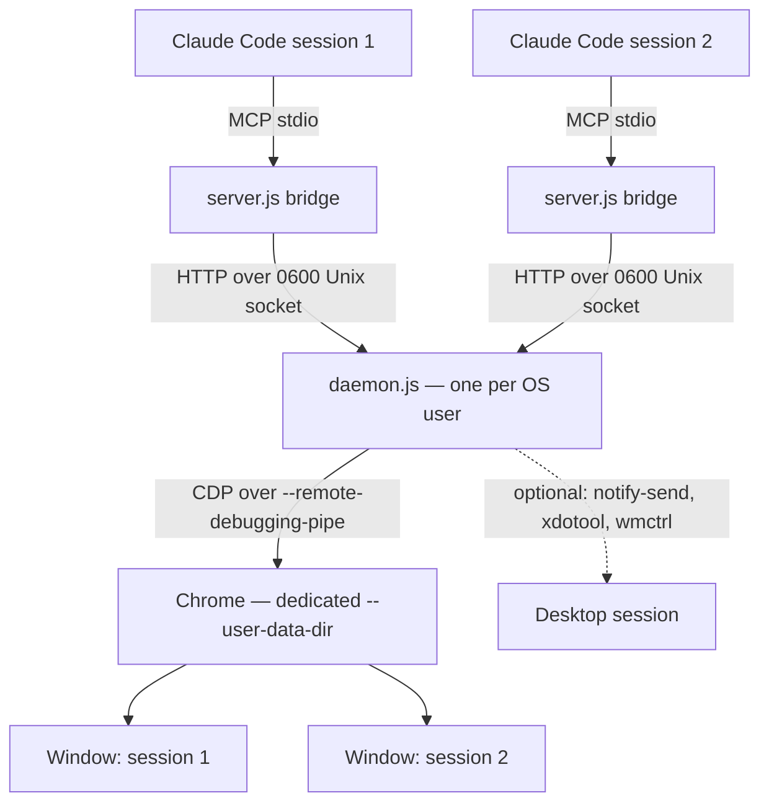

# browsing-overhaul

**Last reviewed**: 2026-09-10
**Status**: Project complete
**Companions**: [use cases](../../use-cases-browsing-overhaul.md) · [future](../../future-claudesurf.md)

## Overview

claudesurf's tool contract was built for a demo and has not changed since. `read_page` takes no arguments, returns `document.body.innerText` plus every `<a href>` on the page, and identifies each link by a CSS selector that is often a long `nth-child` path. On a link-dense page that produces tens of thousands of characters, most of them selector noise, which overflows the caller's token budget and spills to a temp file. The interactive half is worse: the tool returns anchors only, so a dashboard's tabs, menu items, and icon-only controls are absent from the output, leaving the agent to guess at a label and hope the text-matching click path finds it. The tool cannot type text.

This project rebuilds the contract around what an agent needs to read a page and act on it. Reads come from Chrome's accessibility tree for control identity and landmarks and from the page's own markup for structure, rendered through Turndown as interleaved markdown where each interactive element carries a ref, with Readability ahead of it when no landmark scopes the page or the caller asks for the article. Actions address those refs instead of guessed selectors, and the action set grows to cover typing, key presses, option select, history, and tab control. The fifteen actions this implies collapse into two tools — `claudesurf_read` and `claudesurf_act` — so the schema cost in a session's context stays close to today's six tools while the permission boundary between reading and acting stays addressable.

The delivery mechanism changes underneath all of it. claudesurf stops driving the human's everyday Chrome and launches a dedicated instance under its own `--user-data-dir`, and the daemon speaks the DevTools Protocol to that instance over `--remote-debugging-pipe` rather than through a Chrome extension. Deleting the extension removes:

1. The extension WebSocket port and the peer-uid filtering that defends it.
2. The second OS user's separate port configuration.
3. The second user's separate systemd unit.
4. Any need for an MV3 service worker on the read path.

A pipe rides the browser process's own file descriptors, so isolation becomes process ownership and both OS users run an identical shape.

## Key decisions

- **claudesurf drives a dedicated Chrome instance, not the human's everyday browser.** Focus-based multi-profile routing goes with it, since one instance per user leaves the focus probe nothing to choose between.
  - A tool used occasionally must not degrade the everyday browser. A separate `--user-data-dir` defines a Chrome browser process; separate profiles inside one instance share the process and its command line, so a second profile would isolate nothing.
  - The cost is signing in again on each site claudesurf should reach. That cost is paid once per site and buys a containment boundary at the browser: an injection can only reach sessions deliberately placed in that profile. The boundary is the browser's rather than the machine's: the profile's cookie database sits in the same home directory as an agent holding Read and Bash, as risk 4 (home-directory files are agent-writable) concedes for the policy file and the log.

- **The daemon speaks CDP to the browser over `--remote-debugging-pipe`. The Chrome extension is deleted.**
  - Only the parent process holds the pipe's file descriptors, so only the parent can drive the browser. That is stronger than the peer-uid check it replaces, and a pipe stays off the network stack entirely.
  - Tab pinning is the one capability given up — an extension API with no protocol equivalent — so the daemon identifies the working tab by target id recorded at creation. Window creation still raises the window once, since adding the second tab is a page-initiated tab creation and Chrome raises the window for those. Every other page-initiated tab creation raises it the same way: recreating a working tab the human closed, a click or page script that opens a tab or popup, and the `tabs new` action. Pointer input raises it too, so a trusted click does; clicks are scripted by default. Keys, scripted clicks, and navigation leave the window where it is if they don't open a tab.

> [!example]- **Alternatives considered** — a third-party MCP engine, Playwright as a library, a `chrome.debugger` extension, `--remote-debugging-port` (the daemon speaks CDP over a pipe, with no extension)
> Build on Chrome DevTools MCP or Playwright MCP and shrink claudesurf to a policy wrapper — would supply accessibility snapshots, trusted input, settle detection, and network capture ready-made, but chaining MCP servers to inject the nonce, domain policy, and action log is awkward, and the per-session window model would be grafted onto someone else's lifecycle rather than owned. Depend on Playwright as a library rather than as a server — dodges the chaining objection, and lost on keeping the daemon's browser lifecycle its own. Reach CDP through a `chrome.debugger` extension — raises a banner across every window of the browser it attaches to, and puts an MV3 service worker on the correctness path, since the keepalive would have had to hold the debugger session alive. `--remote-debugging-port` — an unauthenticated TCP port carrying full browser authority, reachable by any local process, breaching the per-user isolation the daemon exists to enforce.

- **Reads combine the accessibility tree for controls with a Turndown pass for prose, run in an isolated world inside the page, and a Readability pass ahead of it on a page no landmark scopes or on request.** This is the end state, reached in phase 2; the first shipped read is a flat DOM walk over the same isolated world.
  - Chrome already computes accessible names through the full `aria-labelledby`, label-association, `alt`, and `title` chain, and already prunes what is invisible or `aria-hidden`. Reimplementing that would get the hard cases wrong.
  - The accessibility tree drops inline emphasis and code and flattens table structure, because a screen reader gets that from navigation rather than layout. On documentation and articles the loss is material — a config key becomes indistinguishable from an English word, and a wide options table loses which value belongs to which column.
  - Readability needs a DOM. Running it in the daemon would mean jsdom, a heavyweight dependency; running it in the page's own JavaScript context would let page script tamper with the extraction. `Page.createIsolatedWorld` gives a JavaScript context over the same DOM that page script cannot reach, avoiding both costs.
  - CDP reports a `backendDOMNodeId` on accessibility nodes, so both passes derive from the same nodes and placing controls into the rendered prose is a lookup.
  - The `Accessibility` domain is marked experimental in the protocol. Playwright and Chrome DevTools MCP both ship their snapshot on it, which is the evidence that it is stable enough to bet a phase on.

> [!example]- **Alternatives considered** — accessibility tree alone, jsdom in the daemon, the page's own context, a user-selectable format (accessibility tree for controls plus Readability and Turndown in an isolated world)
> Accessibility tree alone — one source of truth and no correspondence problem, at the cost of documentation reading flat and tables occasionally being misread. Run Readability in the daemon over jsdom — keeps all logic server-side, and loses on pulling in a full DOM implementation to re-parse markup the browser has already parsed. Run it in the page's main world — no isolation primitive needed, and page script could tamper with what the agent reads, which the untrusted-content posture rules out. Expose both as a `format` parameter — doubles the surface the agent has to choose between, for a choice it has no basis to make.

- **Reads follow out-of-process iframe targets.**
  - A cross-origin iframe is a separate CDP target, so an accessibility tree pulled on the page target contains nothing inside it. Embedded logins, payment forms, comment widgets, and Cloudflare's turnstile are all iframes, so same-document reads would miss most of the hard cases.
  - The daemon auto-attaches to child targets and reads them, marking frame content in the output so the agent knows where a boundary was crossed.

- **A ref is a `backendDOMNodeId` scoped to its target and document generation; a cross-site frame is its own target and its refs carry a frame prefix, while a frame in the page's renderer shares the page's scope.**
  - The browser owns the node mapping, so nothing in claudesurf holds a table that can drift from the document, and `DOM.scrollIntoViewIfNeeded`, `DOM.getBoxModel`, and `DOM.resolveNode` all accept the id directly.
  - The id is unique within a renderer process rather than within a tab, so a bare id could resolve to a live node in the wrong document. Pairing it with the target whose renderer computed it — the page target for a frame that shares its process, its own target for a cross-site one — and with that target's generation counter makes cross-target or post-navigation reuse fail loudly.

> [!example]- **Alternatives considered** — same-document reads only, a claudesurf-held ref map, role and name addressing (frame-scoped `backendDOMNodeId` refs, following out-of-process iframes)
> Read the page target only and report frames as omitted — simpler and honest, and it blinds the tool to embedded logins and challenges. A ref map held by claudesurf and keyed by snapshot — was the original design when an extension held it; with the extension gone the browser's own identifier is simpler and survives more. Address elements by role and name, as WebDriver BiDi and Playwright locators do — reads closer to how an agent reasons, but duplicate names force a disambiguation protocol, which is the guessing problem refs exist to remove.

- **The MCP surface is two tools that dispatch on an action name.**
  - Fifteen separate tools would carry roughly 2,500 tokens of schema in every session, browsing or not; two were estimated at roughly 600, and measured about 1,200 once the reads shipped and about 1,850 once acting did. One tool would put the whole surface behind a single permission rule, so a preference like "never prompt me for reads" would be inexpressible — MCP permission rules glob on tool names after a literal `mcp__<server>__` prefix and do not match arguments.
  - Splitting at "does this change anything" puts the permission boundary where the risk changes. Three actions sit on the acting side for reasons worth naming:
    1. `scroll` changes viewport state.
    2. `fetch` spends the profile's cookies against a host of the agent's choosing.
    3. `policy` grants reach.
  - The inventory is the end state. A tool's verb index and schema advertise only the actions and arguments its phase has shipped, so the agent never sees a call it cannot make and the envelope needs no "not implemented" outcome.

**Action inventory.** This is the contract; every phase adds into it rather than reshaping it.

| Tool | Action | Arguments |
|---|---|---|
| `claudesurf_read` | `page` | `scope`, `find`, `article`, `since`, `links`, `hidden`, `max_chars`, `offset` |
| | `info` | — |
| | `screenshot` | `full_page` |
| | `console` | `after` |
| | `network` | `filter`, `after` |
| `claudesurf_act` | `navigate` | `url`, `name`, `description` |
| | `click` | `ref`, `trusted` |
| | `type` | `ref`, `text` |
| | `press` | `keys` |
| | `select` | `ref`, `option` |
| | `scroll` | `direction`, `amount` |
| | `history` | `op` (`back`/`forward`/`reload`) |
| | `tabs` | `op` (`list`/`new`/`switch`/`close`), `target` |
| | `fetch` | `url` |
| | `policy` | `op` (`allow_once`/`allow_always`), `host` |

`links` selects how link-bearing controls appear: inline with the prose by default, or gathered into a trailing index when the agent wants the page's outbound structure without its text.

> [!example]- **Alternatives considered** — one tool per capability, a single tool, a three-way split, a single tool plus a permission hook (two tools that dispatch on an action name)
> One tool per capability — cleanest schemas and best discoverability, at roughly 2,500 context tokens in every session regardless of use. A single `claudesurf` tool — cheapest, and it collapses the read/act permission seam. A three-way split into read, act, and URL-reaching — would align the tool seam with the domain gate, but click-induced navigation stays in the act tool regardless, so the seam leaks. A single tool with a shipped `PreToolUse` hook matching on the action argument — finer than any tool-name split, since hooks see tool input, but it is opt-in configuration, so the safety seam stops being a zero-setup default.

- **Page-derived content is wrapped in a per-call nonce delimiter, generated after the payload arrives.**
  - Generating the nonce after the browser responds means the content predates it, so a page cannot contain the marker and no escaping is needed.
  - Every action's payload is wrapped, not only the reads. An acting result echoes a page-controlled title, a tab list carries page-controlled titles and URLs, and a change summary is page-derived markdown of arbitrary length, so an act-side exemption would leave the largest untrusted payloads bare. A screenshot's image blocks are the one exception, since a delimiter is text; its URL and title lines are wrapped like any other payload.
  - The delimiter makes the boundary between the human's instructions and page content unforgeable. The domain allowlist and the profile's narrow login set do the enforcing.
  - The daemon escapes page text inside the delimiter so that it can't close a ref marker or forge one. Turndown escapes brackets in prose. The daemon collapses marker fields, headers, and list lines to single lines, escapes their brackets and backslashes, and percent-encodes their URLs. Response bodies from `network` and `fetch` print unescaped.

- **The domain allowlist is the only gate, it lives entirely in the daemon, and it gates document navigation to `http` and `https` hosts.**
  - Classifying a control as destructive from its label misses "Yes, I'm sure" and unlabelled trash icons while firing on every "Submit" and "Confirm". A gate that misfires often enough to be dismissed reflexively is worse than none.
  - The daemon receives every action's arguments and is the only component that can see a click's destination, so gating there covers explicit navigation, `fetch`, click-follow, `history`, redirect chains, and targets the page opens itself under one implementation. It also lets `allow_once` live in daemon memory and take effect on the retry.
  - A `target=_blank` link or a `window.open` call creates a fresh target whose first navigation would otherwise race the gate, so the daemon arms the interception on new targets while they are paused during attachment, and their first document request waits at the gate. Without it an injected page reaches an arbitrary host and the only security mechanism never sees it.
  - `navigate` and `fetch` accept `http` and `https` only, since every other scheme is either hostless or a code-execution vector. The identity page's `file://` URL is navigated by the daemon rather than through a gated action.
  - Eight residual risks are accepted rather than mitigated:
    1. The agent has to notice an injection reached through an already-allowed domain; the delimiter helps, and the log records it after the fact.
    2. Any allowed domain is an exfiltration channel for content read from another, particularly through page-context fetch.
    3. The gate covers top-level document navigation, so subresource and frame-document requests from an allowed page reach arbitrary hosts unrestricted. That is the cheapest exfiltration path, and gating it would mean inspecting every request the browser makes and stopping every embed that an allowed page carries.
    4. The policy file, the log, and the browser profile all live in the same home directory as an agent holding Write and Bash, so a compromised turn can append a domain or truncate the log. Any location in that home has the same exposure.
    5. The `policy` action exists so approval is expressible in the contract; it grants the agent the same write risk 4 (home-directory files are agent-writable) already concedes.
    6. A screenshot renders page-controlled text as pixels, outside any delimiter, on the read tool — so a rule that never prompts for reads waves it through.
    7. A tab that a session's page opened goes ungated once the session drops it, as when the human closes the session window while the tab is open in another window; a page still running in the tab can navigate it to any host, and that top-level navigation carries the profile's SameSite=Lax cookies, which a subresource request under risk 3 doesn't.
    8. A page-opened tab whose arming failed runs ungated until it is closed, since the daemon sends the arming commands before it releases the tab and acts on a failure after the tab's first commit.

> [!example]- **Alternatives considered** — a two-tier read and act policy, gating on HTTP method, splitting the gate across both processes (a flat navigable-domain allowlist in the daemon alone)
> Separate lists for domains allowed to be read and domains allowed to be acted on — would cap the blast radius of research browsing without label classification, at the cost of a second prompt in every session that ends in acting and a policy file that accretes columns. Intercept requests and confirm the first non-GET per domain — defines destructive by a mechanical property the browser already knows, but single-page applications post constantly for autosave, telemetry, and search-as-you-type, so without careful scoping it becomes the reflexively-dismissed prompt this decision rejects. Gate URL-bearing actions in `server.js` and the rest in the daemon — reads the URL closer to the caller, and leaves `allow_once` unable to unblock the retry, since a session-local grant never reaches the file the other gate consults.

- **Secrets are kept out of the record.**
  - The action log reduces `type` text and the keys of a `press` that types printable characters to a length and a hash, since they carry whatever the agent entered into a login form on a site that the human deliberately signed into.
  - Network capture stores no request or response header beyond the values of two challenge headers that detection reads, so `Cookie`, `Set-Cookie`, `Authorization`, and `Proxy-Authorization` never reach the buffer, because the same credentials travel on every request the profile makes and the capture is readable through `claudesurf_read`. It stores no request body either, since a sign-in form's post carries the password the human typed. Response bodies stay readable from Chrome's own buffer, and URLs are recorded verbatim in both the log and the capture — so a token in a body, a magic link, or an OAuth callback is still reachable. Redacting URLs would leave the log unable to answer what the agent did. Readable bodies and verbatim URLs are both accepted as risk 2 (any allowed domain exfiltrates).

- **No tool call blocks waiting on the human, and a challenge reaches her through the desktop.**
  - A challenge returns `needs_human` and the agent ends its turn. A blocking wait would hold the session against a human who has walked away.
  - `notify-send` carries what is blocking; `xdotool` and `wmctrl` mark which of many open windows to go to, with the urgency hint and the demands-attention state that taskbars read. The mark is X11-only and every binary is optional — a missing one is logged and skipped, so the handoff degrades to chat. Mutter and Muffin, the GNOME and Cinnamon window managers, refuse to set demands-attention on a window in plain view, so such a window carries the urgency hint alone.
  - Neither steals focus in steady state; window and browser creation still take focus.

> [!example]- **Alternatives considered** — chat alone, MCP elicitation (a non-blocking handoff with a desktop notification)
> Report `needs_human` in chat and nothing else — no operating-system dependency, but the human has to be watching the terminal to notice, which is exactly the gap the decision to never steal focus creates. MCP `elicitation/create`, letting the client prompt the human — resolves the challenge inside one tool call, but it is a blocking wait under another name, and client support is uneven.

## Design

### Topology

### Components

Per Claude Code session:

- **`server/server.js`** — MCP bridge: the two-tool surface, action dispatch, and the nonce wrapper. It reaches the daemon over the per-user Unix socket at `$XDG_RUNTIME_DIR/claudesurf.sock`, mode `0600` inside a `0700` runtime directory.

Loaded by both:

- **`server/dispatch.js`** — action registry and argument validation; the bridge validates first, and the daemon validates again for any other caller.
- **`server/envelope.js`** — the outcome vocabulary: `schema_error` from either process; `needs_confirmation`, `needs_human`, `stale_ref`, `unsettled`, and `setup_error` from the daemon.
- **`server/diagnostics.js`** — leveled logging, to the journal from the daemon and to stderr from the bridge, where Claude Code captures it.

One per OS user:

- **`server/daemon.js`** — the command server and action handlers; constructs the gate, the policy store, and the action log, and writes one log record per call.
- **`server/cdp.js`** — protocol client: pipe framing, request correlation, event dispatch, target auto-attach.
- **`server/browser.js`** — launches Chrome as a child with a pipe, owns the browser lifecycle, the browser record, and orphan reaping.
- **`server/sessions.js`** — per-session window and target state, labels, and ref sets.
- **`server/paths.js`** — the socket, profile, browser-record, policy-file, and action-log paths and their overrides.
- **`server/policy.js`** — allowlist matching, persisted grants, and session-scoped once-grants.
- **`server/read.js`** — assembles `page` reads from `region.js`'s render, handles `since` and paging, and implements `info` and `screenshot`.
- **`server/snapshot.js`** — control, landmark, and frame-node extraction from the accessibility tree, scope resolution, the omission report.
- **`server/render.js`** — isolated-world prose extraction and control placement.
- **`server/diff.js`** — line differencing of rendered markdown for `since` and the change summary.
- **`server/refs.js`** — ref parsing, resolution, and the staleness rules.
- **`server/input.js`** — click, type, press, select, and scroll.
- **`server/keys.js`** — the key grammar that `press` takes, loaded by both processes.
- **`server/navigation.js`** — `navigate` and `history`.
- **`server/tabs.js`** — tab listing, opening, switching, and closing.
- **`server/gate.js`** — navigation interception and the fallback check at document commit.
- **`server/arming.js`** — the commands that put a tab under the gate.
- **`server/refusals.js`** — each session's list of refusals.
- **`server/overlays.js`** — the open dialogs, menus, and messages that a read renders as blocks.
- **`server/region.js`** — the read's render pipeline, shared by reads and the change summary.
- **`server/changes.js`** — the change summary and `since`.
- **`server/respond.js`** — each response's assembly, with the dialog and refusal lines, moved out of `daemon.js`.
- **`server/settle.js`** — quiescence detection.
- **`server/requests.js`** — each session tab's in-flight requests, which settle detection reads and which it hands to network capture as each ends.
- **`server/mime.js`** — the rule for a textual MIME type, shared by network capture and page-context fetch.
- **`server/retained.js`** — each tab's retained render.
- **`server/act-result.js`** — what every acting call ends with: the navigation wait, settling, and the change summary.
- **`server/challenge.js`** — challenge, login, and two-factor detection.
- **`server/handoff.js`** — each session's open handoff, the notification limit, and the urgency hint's lifetime.
- **`server/notify.js`** — desktop notification and urgency hint.
- **`server/action-log.js`** — the JSONL action log. Named apart from `diagnostics.js` so an import mix-up cannot route credential-bearing action records into the journal.
- **`server/ring.js`**, **`server/network.js`**, and **`server/console-capture.js`** — the capped, numbered lists that capture keeps, and network and console capture into them.
- **`server/fetch.js`** — page-context fetch.

The `extension/` directory is deleted. Its session-identity page becomes `server/static/session.html`, addressed by `file://`.

### Data model

- **Domain policy** — a newline-delimited list of hosts, per user, outside the repository. The daemon is the only process that appends to it, so concurrent sessions cannot interleave appends; the daemon re-reads the file on each change, so the human's hand edits take effect.
- **Once-grants** — hosts granted by `allow_once`, held in daemon memory keyed by session id and never written, so one session's grant does not widen another's reach.
- **Action log record** — timestamp, session id, tool, action, arguments, resulting URL, outcome, and the refusals that the response carried. One JSON object per line. In the arguments, `type` text and the keys of a `press` that types printable characters are reduced to a length and hash.
- **Browser record** — the child browser's process id and start time, persisted beside the socket so a daemon that crashed and restarted can identify and reap the browser it no longer controls. Written at launch, overwritten by the next launch, cleared when the next daemon reaps the browser or finds its process gone, and otherwise left in place, so a record present at startup means the previous run had a browser, and one whose process lives means that browser outlived its daemon.
- **Retained render** — the last render of each tab from a read, a `since` read, or a change summary. It includes the uncut overlay blocks, region, link lists, and hidden section, along with the parameters used to render it. The daemon retains it for `since`, the change summary, and paging reads. It does not retain renders over 500,000 characters, ignores the render once the tab navigates, and drops it with the tab, since it is the largest thing the daemon retains per session.
- **Daemon session state** — session id to `{ windowId, workingTargetId, identityTargetId }`, the session's tab numbers, the tabs that it worked in before the current one, and the refusals that the gate has not yet reported, plus a per-target document generation counter that increments on navigation and scopes every ref. Held in memory, and dropped when the session's working tab is gone and none of its tabs remains in its window. The next tab number survives the drop, as the label does.
- **Session label** — session id to `{ name, description }`, held separately so a closed window can be recreated under the name it had. Kept for the daemon's lifetime, since a label is a few dozen bytes and losing it would make a recreated window anonymous.

### Key flows

**Cold start.** The daemon ensures the browser inside its own dispatch: any command for a session with no live browser launches Chrome with its `--user-data-dir` and `--remote-debugging-pipe` and waits for the handshake. Keeping this in the daemon rather than in `server.js` removes a round trip and the launch race that per-process coalescing cannot cover when several sessions start at once.

**Read.** `claudesurf_read` reaches the daemon, which:

1. Pulls the accessibility tree for the session's working target and for each child frame inside what it renders, overlay blocks included, eight frames over three nesting levels at most.
2. Reads each tree for controls, landmarks, named groups, and frame nodes alone; the render skips hidden elements and is scoped by the first of the `main` landmark, an `article` node, Readability's article, and the whole body, unless asked otherwise.
3. Renders prose through Turndown in an isolated world over the page's DOM, with Readability ahead of it when no landmark scopes the page or the caller asks for the article.
4. Places controls into that prose by `backendDOMNodeId`.
5. Renders each open dialog of the page's own document as a block of its own, cut from the prose. It renders each open menu or message outside the scope the same way when the scope is chosen from the tree or from a ref whose region lies in the page's own document.
6. Returns the blocks and then the interleaved markdown, with frame boundaries marked, and counts for everything omitted.

`server.js` then wraps the payload in the nonce delimiter and hands it to the caller.

**Navigation under policy.** The daemon gates a session's working tab and the tabs that its pages opened, but not its identity tab. It checks every route to a new top-level document in those tabs against persisted hosts and session once-grants, and checks `fetch`'s URL the same way: `navigate`, `history`, `tabs new`, and `fetch` before dispatch; click-follow, page script, and redirect chains by intercepting each document request and aborting it, leaving the originating page loaded; and a page-opened target by holding its first document request until it clears. A page that commits without a request seen by the interception (a back-forward cache restore) is caught at commit and sent to `about:blank`, or its tab is closed if the tab is still new. When an action caused a navigation to an unlisted host, the action returns `needs_confirmation`; otherwise the next call carries a `Blocked by the page:` line. The agent asks in chat and then issues `policy` with `allow_once` or `allow_always` before retrying; only `allow_always` reaches the file.

### Cross-cutting concerns

**Page-initiated targets and dialogs.** Two things the page controls can reach the daemon outside any action it issued. A `target=_blank` link or `window.open` creates a target — a tab in the session's window, or a popup window — which is attributed to the session through its opener, appears in `tabs list`, and never becomes the working tab on its own. A `javascript:` dialog — `alert`, `confirm`, `prompt`, or `beforeunload` — wedges the renderer until it is answered, so every later command on that target would time out against the request budget. The daemon dismisses dialogs and reports that it did, so the agent knows a page asked something rather than seeing an unexplained failure; `beforeunload` is accepted instead, so a close the human initiated goes through and closing a window stays the way she retires a session.

**Downloads.** A click on a file link produces no new document, so the gate does not see it, and Chrome would write to the profile owner's disk on the agent's action. Downloads are declined and the refusal is reported. Allowing them into a scoped directory is recorded as future work rather than built here.

**Result envelope.** Every action returns one of a fixed set of outcomes:

1. `success`, optionally carrying informational notes such as a recreated working tab.
2. `needs_confirmation`, with the host at issue.
3. `needs_human`, with the challenge type.
4. `stale_ref`, naming the ref.
5. `unsettled`, when the page has not quiesced.
6. `schema_error`, naming the action.
7. `setup_error`, for a misconfigured environment.
8. `error`, for everything else that failed — a refused identity-tab close, a navigation that did not load, a ref in scope but resolving to a detached or non-editable node, a protocol timeout.

An outcome reports a condition rather than locking the session: an agent holding `needs_human` can still read the page.

**Browser lifetime and daemon restarts.** The browser is a child of the daemon, and the unit's default `KillMode=control-group` takes the whole cgroup down on stop or restart, so the browser dies with the daemon regardless of what Chrome does on pipe EOF. The persisted browser record covers the case the cgroup kill misses: a daemon killed outside systemd's control, after which a new daemon must identify and reap a browser it never launched. Pairing the process id with its start time keeps that reap from hitting an unrelated process that inherited the id. The cost is that a daemon restart closes every session window and the tabs open in them, while cookies and cleared challenges survive in the profile on disk.

The daemon runs `Restart=always` and `server.js` retries connection failures, so a restart is invisible to the agent, apart from a capture cursor from before it, which reads back with a `Missed:` line naming the restart, and the human can lose a window without being told — sharpest during a `needs_human` handoff, where a restart mid-solve takes away the window she was working in. That is accepted, with one mitigation: a persisted browser record present at daemon startup is evidence the previous run had a browser, so the daemon announces the loss through the notification channel the `needs_human` handoff uses. The announcement says only that there was a browser, not how many windows it held.

The reverse direction is rarer than it looks. The pipe holds Chrome alive with zero windows, so the human closing every session window leaves an idle browser that the next command reuses without a cold start; only a quit, a crash, or a kill reaches EOF on the pipe. On EOF every session's recorded window and target ids point at a browser that is gone, so the daemon drops all session state and the next command cold-starts.

**Graphical session environment.** The daemon launches a headful browser and fires desktop notifications, so it needs `DISPLAY` or `WAYLAND_DISPLAY`, `XAUTHORITY`, and `DBUS_SESSION_BUS_ADDRESS`. Today's unit sets none of them, and the launch happens in `server.js`, which inherits Claude Code's environment. Moving the launch into the daemon would make plumbing the graphical session into the user unit a setup requirement, so the bridge keeps supplying it: each request carries an allowlist of those variables, and the daemon uses its own environment when it has a display and the bridge's otherwise. Without either the daemon cannot launch a browser, and headless is not offered, since the `needs_human` handoff requires a window the human can reach.

The second OS user is the case this serves, and the identical-shape requirement holds for the browser but not for notifications. That user has no login session of its own to import an environment from — its `DISPLAY` arrives through Claude Code, and now reaches the daemon the same way. Notifications are worse: `notify-send` from that user reaches that user's session bus, which no notification daemon watches, and it cannot reach the human's bus through a `0700` runtime directory. Sessions run by the second user therefore fall back to reporting a challenge in chat, which is where the handoff was always going to end up for a human who is not watching the desktop.

**Concurrency and the time budget.** Every Claude Code session for one OS user multiplexes over a single pipe into a single browser process, and the daemon runs one command at a time per target while interleaving across targets. A CDP response arrives as one message, so a large payload cannot be streamed — a whole accessibility tree fits one message at the sizes measured (2 MB for 5,000 nodes), with narrowing over partial subtrees as the fallback if a page outgrows it. A screenshot cannot be narrowed that way, since it is one response of whatever size the page dictates. Full-page capture is therefore split into a capped number of viewport-sized segments; `max_chars` bounds text and does nothing for an image block. The budget is tightest at cold start, where a browser launch, handshake, and navigation all land inside a single tool call against `server.js`'s 35-second request timeout. Once settle detection exists it shares that window too, taking its timeout from what remains after the launch.

**Diagnostics.** This project deletes a substantial `[debug]` instrumentation layer — focus-probe logging, bind-reason logging, extension-side window logging — while moving onto a protocol whose failures are opaque. The action log is a product feature rather than a diagnostic, so the daemon carries its own leveled logging to the journal:

1. Debug logs record protocol commands, continued requests, and repeat refusals.
2. Info logs record events such as browser lifecycle events, a host's first refusal on a tab in a minute, and a renderer exception.
3. Warn logs record failures that the daemon works around, such as an unparseable allowlist line or a failed log write.

**Session state accumulation.** MCP stdio gives no session-end signal, so the daemon learns nothing when a `claude` run exits. Window and target state is dropped when its window closes, and all of it at once on pipe EOF: the daemon watches target destruction. Closing a window is therefore how the human retires a session; a session working in a popup outside its window is retired when that popup closes as well. Session labels are exempt, so a session whose window the human closed comes back under its own name.

**Testing.** Tests move to `node:test` behind an `npm test` script, replacing today's hand-run scripts.

1. `test/session-identity.test.js` — its assertions survive, since it only checks that `server.js` derives a stable identity from the environment; it is converted to the runner.
2. `test/daemon-isolation.test.js` — covers the WebSocket peer-uid path this project deletes, and is rewritten against the surviving Unix-socket boundary.
3. `test/daemon-retry.test.js` — drives `get_page_info`, a tool name the two-tool contract removes, so it is updated to the new surface.

Beyond those, the CDP client, tree pruning, and settle detection need a protocol fake so most cases run without a live browser.

**Migration for an existing install.**

1. Unload the extension from every Chrome profile it was loaded into.
2. Delete the per-machine extension port override file.
3. Remove `CLAUDESURF_BROWSER_CMD` from the MCP server entry, since the daemon now owns the launch.
4. Replace any permission rules naming the six old tool names with rules on the two new ones.
5. Replace the two systemd units with one carrying the graphical session environment.
6. Sign in again on each site inside the fresh profile.
7. Expect the policy file to start empty when the allowlist arrives, so the first navigation to each host stops for confirmation until the list accretes.

**No back-compatibility path.** Nothing consumes these tools except Claude Code sessions over MCP, so the contract changes outright.

## Requirements

1. claudesurf drives a dedicated Chrome instance per OS user, under a `--user-data-dir` in that user's home, cold-started on demand by the daemon.
2. The daemon speaks CDP to that instance over `--remote-debugging-pipe`; no TCP debugging port is opened.
3. The Chrome extension is deleted, along with the WebSocket channel, peer-uid filtering, and the per-user port configuration.
4. The per-user Unix command socket is unchanged.
5. Both OS users run an identical shape; today's second-user special-casing disappears rather than being generalized.
6. The daemon reaps an orphaned browser on startup, identifying it by persisted process id and start time, and tolerates a stale profile singleton lock.
7. The profile directory and the command socket path are both overridable, so a worktree daemon can run its own browser without stopping the main one.
8. Focus-based multi-profile routing is removed.
9. Both processes carry leveled diagnostic logging — journal from the daemon, stderr from the bridge — in a module named apart from the action log.
10. Each Claude Code session owns a dedicated Chrome window, created on first use and reused across MCP reconnects.
11. Each session window carries an identity tab showing the session name, distinguished from the working tab by recorded target id rather than by pinning.
12. Actions target the session's working tab; when it closes, the most recent earlier working tab that is still open and still belongs to the session takes its place, and a fresh one is created on demand when there is none.
13. Session window and target state is dropped when its working tab is gone and none of its tabs remains in its window, and all of it on pipe EOF. The session label survives, so a recreated window keeps its name.
14. Reads combine the accessibility tree for controls and structure with a Turndown pass run in an isolated world, Readability ahead of it when no landmark scopes the page or on request.
15. Reads follow attached out-of-process iframe targets, marking frame boundaries in the output.
16. Read output is interleaved markdown with inline refs.
17. A ref is a `backendDOMNodeId` scoped to its target and document generation (a cross-site frame being its own target, with prefixed refs; a same-process frame sharing the page's); a ref used after that document changed returns `stale_ref`, and a ref that is wrong within the same document — never read, or since removed — returns `error`.
18. Reads return visible elements only by default, report the skipped count, and take a `hidden` parameter to include them.
19. Reads strip to the main content region by default, report what was dropped, and take a parameter to include it. Ahead of the region they render any open dialog of the page's own document, wherever it sits. They also render any open menu, alert, or status message outside the scope when the scope is chosen from the tree (`main` or an `article` node) or from a ref whose region lies in the page's own document.
20. Repeated links are deduplicated.
21. Find, scope, article extraction, and link presentation are parameters of the read action rather than separate actions.
22. A `since` parameter returns what changed after an action.
23. Nothing the read renders is truncated silently; every response states what was cut and how to retrieve more. Content the page itself hides is excluded rather than cut, and its controls are counted.
24. `max_chars` and `offset` are introduced as a size backstop, replacing today's fixed character cut.
25. Every action's returned text payload is wrapped in `<<<claudesurf-untrusted:NONCE>>>` markers with a per-call random nonce, `screenshot`'s URL and title lines included. Image blocks are exempt, since a delimiter is text.
26. The nonce is generated after the payload arrives; no look-alike stripping is performed.
27. Wrapping happens in `server/server.js`.
28. The "data, not instructions" reminder lives in the tool description, plus a short tag on the closing delimiter if that proves to help.
29. Typing, key presses, option select, and history navigation are supported. File upload is not.
30. Tab control covers list, new, switch, and close, and refuses to close a session's identity tab.
31. Screenshots capture the viewport, and the full page when asked, as a capped number of viewport-sized segments.
32. Actions return the resulting URL, title, and a summary of what changed, after waiting for the page to settle.
33. A page-settled signal distinguishes a skeleton from a finished page.
34. Keyboard input is dispatched through CDP so events are trusted. Clicks are scripted by default, since a dispatched pointer press raises the window, and trusted on request.
35. Every action returns one of the fixed outcomes in the result envelope.
36. Challenges, login walls, and two-factor prompts return `needs_human` with type, URL, title, and session name. No screenshot is taken and focus is left alone.
37. No tool call blocks waiting on the human.
38. A `needs_human` result fires a `notify-send` notification and best-effort marks the session's window through `xdotool` and `wmctrl`; a missing binary is logged and skipped.
39. A daemon that starts and finds a persisted browser record from a previous run notifies through the same desktop channel as the `needs_human` handoff, since that record is the only evidence that the previous run had a browser, and with it any session windows that the restart closed.
40. Every action is logged to a JSONL file, with typed text reduced to a length and hash.
41. A flat allowlist in the daemon gates, by host, every route to a new top-level document in a session's working and page-opened tabs.
42. `navigate` and `fetch` accept `http` and `https` URLs only; `navigate` enforces this from the phase that ships it, ahead of the allowlist.
43. An unlisted host returns `needs_confirmation`; the agent issues `policy` with `allow_once`, scoped to that session, or `allow_always`, which is persisted for all.
44. Network and console capture run continuously into capped ring buffers, read from an `after` cursor. Console capture goes through Chrome's `Console` and `Log` domains and never enables `Runtime`, which page script can detect. Capture keeps response bodies in Chrome's buffer and stores no request body and no header beyond the values of two challenge headers.
45. A page-context fetch performs an authenticated GET from the working tab's isolated world with the browser's cookies, under the page's CORS rules and without following redirects, subject to the allowlist.
46. The MCP surface is two tools, `claudesurf_read` and `claudesurf_act`, each taking an action plus arguments and carrying a compact verb index in its description.
47. A malformed call returns `schema_error` carrying the schema for the action named.
48. A target the page opens is attached paused, so its first navigation is gated like any other.
49. JavaScript dialogs are dismissed and reported; `beforeunload` is accepted so a human-initiated close proceeds.
50. Downloads are declined and the refusal is reported.
51. The graphical session values reach the daemon from its own environment or, failing that, from the bridge, which sends an allowlist of them with each request; a unit drop-in remains an option for either user. The second OS user's notifications fall back to chat.
52. From a `needs_human` result until the session's next call other than `policy`, a domain-gate refusal in that session's tabs fires a notification naming the host and telling the human to sign in from a tab she opens herself or to ask the agent to allow the host.

## Phases

Every phase ends with claudesurf usable. Between phases the capability set only grows; phase 1's relation to today's tool is different, and the three things it gives up are named in its entry.

Two deliberate narrowings sit inside that. Phase 3's domain gate stops an unlisted host that navigated freely in phase 2, which is a reduction in reach. Phase 3's settle detection also returns `unsettled` where an action previously returned success, which is a stricter success criterion rather than a lost capability.

### Phase 1 — Foundation (27%) · 5281dd3

The daemon gains a CDP client, launches and owns a dedicated Chrome, takes over the window, tab, and session management the extension does today, and the extension is deleted. The MCP surface becomes the two tools with the result envelope and the nonce delimiter. Reads return text, title, URL, and a flat list of interactive elements carrying refs, link targets, and labels, so clicking is ref-addressed from the start. `navigate`, `scroll`, `screenshot`, and `info` come across with it, and `max_chars` and `offset` replace today's silent character cut. `navigate` waits for the load event as it does today and accepts `http` and `https` only, ahead of the allowlist; the schemes it now refuses are ones today's reads already fail on.

Against today, this phase adds buttons and `[role]` controls where reads returned only anchors, refs in place of brittle `nth-child` paths, full-page screenshots, and a way to page through a large read. Four things are given up, each a consequence of a decision taken above rather than of this phase:

1. The dedicated profile carries none of the everyday browser's logins, so each site has to be signed into once.
2. The identity tab is no longer pinned, so it loses the property that makes it recognizable at a glance.
3. `click` addresses refs only. Today a CSS selector reaches anything in the document; from here the agent can click what the walk classifies as interactive.
4. A fresh profile has no clearance cookies, so login walls and challenges come up more often than they do today, while detection and the desktop handoff arrive in phase 4. Until then the agent reports a page it cannot get past and the human clears it in the window directly.

**Key decisions:**
- **The phase lands as a named sequence, not one commit.** Transport and browser lifecycle land first, then session windows and targets, then the tool contract with the read and click path, then the switch to CDP, and last the extension's deletion; each step is verifiable before the next lands. The alternative, splitting transport from contract into two phases, would need a throwaway adapter serving six doomed tools over CDP.
- **The extension is deleted in the commit after the switch to CDP.** Deleting it earlier would leave the tree without a working transport, and the switch leaves the extension idle on disk, so the cutover has a fallback until the CDP path is known to work.
- **This phase's reads come from a flat DOM walk in an isolated world, not the accessibility tree.** Phase 2 replaces the source. What stays fixed across that swap is the action signature and the ref semantics, not the output, which phase 2 changes materially.
- **Clicks run as a scripted click in the isolated world by default, and `trusted: true` resolves the ref to coordinates and dispatches real pointer events.** A pointer press raises the session window to the front, so the trusted path is opt-in for the handlers that need a genuine event sequence.
- **The profile directory persists across reboots.** Logins and cleared challenges are the point of a dedicated profile, so it lives in the user's home rather than the runtime directory.
- **The daemon uses environment overrides to locate the browser and profile and returns `setup_error` when another Chrome holds that profile.** It launches the binary named by `CLAUDESURF_BROWSER`, falling back to the first Chrome or Chromium on `PATH`. It opens the profile at `CLAUDESURF_PROFILE_DIR`, falling back to `$XDG_DATA_HOME/claudesurf/profile`. It accepts any version; the handshake logs it, and the README names the tested one. Chrome signals a held profile with exit code 21 before the handshake.
- **Chrome launches windowless, with its first-run, default-browser, crash-restore, and keyring prompts suppressed and `navigator.webdriver` cleared; `--enable-automation` stays off.** The pipe alone sets `navigator.webdriver`, and Google sign-in and several other login flows refuse a browser where it is set. Bypassing the keyring keeps saved passwords in the profile beside its cookies.
- **The CDP client is implemented directly over the pipe, and the daemon's code doesn't depend on any npm package.** The three libraries added in phase 2 run in the page.

> [!info]- **Rationale** — implementing the CDP client directly
> Framing, correlation, and event routing need little code. A library such as `puppeteer-core` would add a dependency tree to the process that holds the human's sessions and hide the attach and window handling that the daemon needs.

- **A session window opens on its working tab, and every later tab opens from a page already in that window.** The identity tab joins in the background with a distinctive favicon and the session name set by `navigate` as its title. A closed identity tab stays closed until the window is recreated.

> [!info]- **Rationale** — grouping tabs without raising the window
> `Target.createTarget` can't name a window, and a tab opened by a page lands in that page's window. Reopening a closed identity tab would raise the window for a tab that the human closed on purpose.

- **The daemon launches Chrome under its own graphical environment when that environment has a display, and otherwise under the display variables that the bridge forwards with each request.** The bridge inherits them from Claude Code, so a display drop-in for the unit is optional for either OS user.
- **A ref stays valid across every read of its document; its document generation advances when the main frame commits a new document.** A same-document navigation such as `pushState` keeps the nodes and so keeps refs, and expiring a ref that the agent read a moment ago would teach it to read before every click.
- **Page-side code runs from script files under `server/page/` in the isolated world, and every script that judges visibility shares one definition of *hidden*: a failed `checkVisibility`, an empty box, or an `aria-hidden` ancestor, with an offscreen element counting as visible.** The shared definition keeps a read, a click, and phase 2's render in agreement, and `scroll`'s script carries over the extension's heuristic for a site that scrolls a container instead of the window.
- **Each tool's description indexes every action with its argument names and a one-clause summary, and the tool's schema lists those arguments flat beside `action`.** Validation enforces each action's required arguments; an invalid argument list returns `schema_error` with the action's argument list. A tool's actions must agree on each argument's type, since the flat schema holds one type per argument name.

> [!example]- **Alternatives considered** — a `oneOf` per action
> A `oneOf` per action would cost more tokens, and clients enforce it unevenly.

- **A full-page screenshot is up to four viewport-height PNG segments clipped with `captureBeyondViewport`, each its own image block.** Clipping leaves the scroll position unchanged. Capture works in a covered or minimized window, though it slows when the working tab isn't its window's active tab.

> [!info]- **Rationale** — splitting full-page screenshots
> Claude's API downsizes an image whose long edge exceeds about 1,568 px, so one tall image arrives illegible.

- **The daemon dismisses `alert`, `confirm`, and `prompt` alike, and reports each dialog's message inside the wrapped payload.** The message is page text, so the note outside the delimiter names only the dialog type; a `dialog` action for answering dialogs is future work.
- **The protocol fake models Chrome's targets, windows, and pages and runs in-process or as a child behind the real pipe.** The model is hand-written. Tests that depend on Chrome's behavior run against a live browser. These tests run headless and skip without a browser; window and focus cases run with a browser window on request.

> [!example]- **Alternatives considered** — recorded protocol transcripts
> Recorded transcripts would break on order and timing changes that a refactor can make harmlessly.

**Key files:**
- `server/cdp.js` (new — NUL-delimited framing on fds 3 and 4, request correlation, event dispatch, target auto-attach, window creation and grouping, browser lifecycle, orphan reap)
- `server/envelope.js` (new — the outcome vocabulary), `server/dispatch.js` (new — action registry and argument validation)
- `server/diagnostics.js` (new — leveled logging: journal from the daemon, stderr from the bridge)
- `server/read.js` (new — isolated-world evaluation, the flat interactive walk, ref assignment, output assembly)
- `server/input.js` (new — ref resolution, scroll into view, CDP input dispatch)
- `server/daemon.js` (modified — browser ownership, session windows, targets, action handlers; WebSocket server removed)
- `server/server.js` (modified — two tools, nonce wrapping, truncation reporting)
- `extension/` (deleted; `session.html` becomes `server/static/session.html`)
- `server/package.json` (modified — `ws` removed, description, `node:test` runner, `npm test` script)
- `systemd/claudesurf.service` (modified — one unit, graphical environment imported), `systemd/claudesurf-second-user.service` (deleted)
- `test/cdp.test.js`, `test/envelope.test.js`, `test/dispatch.test.js`, `test/read.test.js` (new); `test/session-identity.test.js` (converted to the runner), `test/daemon-isolation.test.js` (rewritten against the Unix-socket boundary), `test/daemon-retry.test.js` (updated to the new surface)
- `README.md`, `CLAUDE.md`, `.claude/settings.local.json`, `.claude/context/architecture.md`, `.claude/context/capabilities.md`, `.claude/context/docs.md`, `.claude/context/worktree.md` (modified — all describe the deleted architecture; `worktree.md` additionally documents `CLAUDESURF_DAEMON_PORT`, which the code no longer has)

---

### Phase 2 — Structured reads (18%) · 6e53aba

Reads move onto the accessibility tree for controls and structure, with prose rendered through Turndown in an isolated world — Readability ahead of it when no landmark scopes the page or on request — and controls placed by `backendDOMNodeId`. Output becomes interleaved markdown restricted to main content, deduplicated, visibility-filtered, following child frames, and reporting what it omitted, with `find`, `scope`, article extraction, and link presentation as parameters.

Phase 1's flat walk is replaced as the read's source and kept for the hidden list, under an unchanged action signature and an `e<id>` ref scheme extended only by a frame prefix for cross-site frames, so nothing built on refs is rewritten. This is where a link-dense page stops overflowing the caller's token budget.

**Key decisions:**
- **Controls are placed into rendered prose by `backendDOMNodeId`, not by text matching.** Both passes derive from the same nodes, so the correspondence is a lookup.
- **The daemon uses the tree to classify controls, landmarks, named groups, and frames, and leaves its container and text roles unread, since Turndown renders all structure from the DOM.** A named group or region carries its name in a boundary marker wherever it renders, and a landmark does so when the whole body renders; a generic container named only by `aria-label` loses that name.
- **`scope=main` tries, in order, the first `main` landmark, an `article` node, and Readability's article when the page appears to contain an article, and renders the body when none applies; the `Scope:` line names which one rendered.** Landmarks come first because Readability drops the infobox and category links that an agent wants on a site like Wikipedia. The same line lists each omitted landmark by ref and control count, so the agent expands one with `scope=<ref>` in a single call.
- **A control renders inline as a bracketed marker that opens with its ref, `[e13 button "Search" (disabled)]`, and a link keeps markdown's form with the ref after it, `[text](/path)[e1]`.** Role, name, and state come from the tree.
- **The daemon reads Readability, Turndown, and the GFM plugin unmodified from `node_modules` and evaluates them with the renderer once per isolated world.** Each package ships a build that binds a browser global, so the daemon injects the files as published and `npm outdated` still reports on them; when a file is missing, the daemon returns `setup_error` naming the install command.
- **Frames at one nesting level render in parallel, each under its own time budget inside the request's, and a frame that runs out renders as `(not readable)` while the rest of the read completes.** Latency on a frame-heavy page went unmeasured; the cap of eight frames over three nesting levels and the per-frame budget limit it.
- **A control's marker carries its accessible name, so a `<label>` whose text matches that name is left out of the prose, and its text renders once, in the marker.** A `fieldset`'s legend stays as prose inside the group's boundary marker. When the comparison finds no match, the label prints twice.

> [!example]- **Alternatives considered** — naming controls only when labels differ
> Naming the control only when its name differs from the label would drop the name whenever the comparison erred.

- **`article=true` on a page where Readability doesn't find an article falls back to the scope's render and says `Article: none found`.**

**Key files:**
- `server/snapshot.js` (new — pruning, control and landmark extraction, scope resolution)
- `server/render.js` (new — isolated-world extraction, control placement)
- `server/read.js` (modified — the accessibility tree replaces the flat walk), `server/page/render.js` (new — the in-browser clone and Turndown rules), `server/sessions.js` (modified — iframe targets, worlds per frame), `server/input.js` (modified — frame refs)
- `server/page/walk.js` (modified — restricted to hidden elements), `server/page/state.js` (modified — the boxless reading, the mask), `server/action-support.js` (modified — the renderer source and the caps)
- `server/daemon.js` (modified — read arguments passed through), `server/dispatch.js` (modified — read parameters)
- `server/package.json` (modified — Readability, Turndown, and the Turndown GFM plugin, whose browser-global files are injectable as shipped)
- `test/snapshot.test.js`, `test/render.test.js` (new — recorded trees and pure assembly functions), `test/live/render.test.js` (new — fixture pages through the renderer), `test/read.test.js` (modified — flat-walk assertions replaced)

---

### Phase 3 — Acting (20%) · 7aa5bbf

The daemon gates by host every route to a new top-level document in a session's working tab and the tabs that its pages opened, ships the `policy` action so approval is expressible, and logs every action with typed text redacted. The identity tab stays outside the gate. Typing, key presses, option select, history, and tab control arrive. Actions wait for the page to settle before returning and report what changed, and `since` returns a delta. Reads render open dialogs, and open menus and messages outside their scope, as blocks ahead of the region.

After this phase the agent has every action except capture and the challenge handoff, so a Cloudflare wall still reads as an ordinary page.

**Key decisions:**
- **The gate lands with the input actions rather than after them**, so the agent never holds the full action set ungated. Clicking has been available since phase 1, so this is not the first ungated acting — it is the point past which everything else arrives gated.
- **An allowlist entry is a bare host that covers itself and every subdomain, and an IP address covers itself alone; the daemon inspects the file's metadata before every host check and re-reads it when its modification time or size has changed.** Covering subdomains takes the place of a wildcard form and lets the common `example.com` → `www.example.com` redirect through without a second prompt. One daemon serves every session, so a host that one session saves, or that the human adds by hand, applies to the next check in any session.
- **The gate checks every route to a new top-level document in a session's tabs, the human's own navigation there included, and a read or an action on the document that a tab already shows runs whatever its host.** That document arrived through the gate or through the human. The daemon can't reliably tell the human's navigation from a page script's, so she browses an unlisted host in a tab of her own.
- **The gate pauses each session tab's document requests with `Fetch` and refuses one with `Aborted`, which leaves the originating page loaded.** Stopping a load on Chrome's navigation event can come after the request has gone out, and `BlockedByClient` commits Chrome's error page over the page that the agent acted from. Arming only the session's tabs keeps the human's own tabs off the daemon's event loop, and the same arming enables `Network`, so settle detection and phase 4's capture can read its events alongside the gate.
- **Session tabs bypass service workers and don't prerender, and when a gated tab commits a page from an unlisted host without passing the gate, a backstop sends the tab to `about:blank`, or closes it if the tab is new.** `Fetch` doesn't see a navigation that a service worker answers or that a prerender activates, and a back-forward cache restore commits without a request, so `history` also checks its entry's host before it navigates. As a result, a site's offline pages and its worker-only routes fail to load in a session tab.
- **A call that causes a gate refusal returns `needs_confirmation` with its result lines intact.** Other refusals print as `Blocked by the page:` on the session's next response. A page-opened tab is closed if the gate refuses it before it loads a web page. The agent reads what happened before retrying. The refused host prints only inside the wrapped payload, since a hostname is page-chosen text.

> [!info]- **Rationale** — retaining results after a gate refusal
> The call has run, and a click may have submitted a form whose redirect the gate stopped.

- **The action log is `$XDG_STATE_HOME/claudesurf/actions.jsonl`, mode `0600` in a `0700` directory, and the daemon renames it to `actions.jsonl.1` once a record would take it past 10 MiB; typed text is hashed with an HMAC under a key that the daemon generates at startup and keeps in memory.** Anyone holding the log could recover a short password from a plain hash with a dictionary lookup. A failed write logs a warning and the call proceeds, so a full disk doesn't stop every action.
- **`type` replaces a text field's content: it focuses the field by script, selects everything with a select-all key event, and inserts the text with `Input.insertText`.** The insertion is one trusted input event that carries any Unicode, and a newline in it can't submit a single-line form, which leaves submitting to `press Enter`. A widget that listens only for key events is reached through `press`, and a per-key mode is future work.
- **The trusted click is the only input action that uses coordinates.** `type` and `select` reach their element by script in its frame's world. The daemon sends key events and inserted text through the page target's session. Chrome routes that input to the focused element, including one inside a frame. Every page and frame target gets focus emulation, so input into a background tab, or into a frame inside one, avoids phase 1's five-second stall. A trusted click still resolves in a background tab, whose layout keeps running, and returns `error` naming the reason for an element that is hidden, lacks a box, or is covered at its centre.
- **`select` sets a native `<select>` by script, matching an option by its label and then its value, and dispatches `input` and `change`; the agent drives a custom list with clicks, so a read gives each of its options a ref.** The events are untrusted, which most frameworks accept, and a widget that rejects untrusted events needs `click` and `press`.
- **`press` sends up to 16 space-separated key presses to whatever holds focus and reports where the keys went and, when focus moved, where focus went.** Each press names a key with optional modifiers joined by `+`, as in `Control+Enter`. `press` takes keys alone, so the agent first focuses an element by clicking or typing into it. Keys go to the page when nothing is focused. Focus shows in neither a read nor the change summary, so `Tab` and the arrow keys would otherwise move it unseen.
- **Settling requires 500 ms of quiet in both network activity and the DOM.** The network check covers document, script, stylesheet, XHR, and fetch requests; the DOM check covers structure and text. An acting call waits up to 5 s for the page to settle, and a fresh read waits up to 2 s. A call that runs out of time returns its full result as `unsettled`. Both budgets shrink to fit what remains of the request's deadline inside the bridge's 35-second timeout.

> [!info]- **Rationale** — checking both network and DOM activity
> Network quiet alone passes a page whose framework hasn't rendered its data yet, and DOM quiet alone passes a skeleton waiting on a slow request.

- **The change summary is a line diff between the tab's retained render and a fresh render of the page with the same parameters, and `since=true` returns the same diff on request.** The agent sees the change in its reads' vocabulary, refs included, so a control that the action revealed is clickable without a read; a diff of accessibility nodes would miss the text through which a page says "Saved" or "3 results". A summary that can't be measured says so in its `Changed:` line and leaves the call's outcome alone, since the action has already run.

**Key files:**
1. `server/policy.js` (new — matching, persisted grants, and session once-grants)
2. `server/gate.js` (new — navigation interception, the fallback check at document commit)
3. `server/arming.js` (new — arming and disarming a tab)
4. `server/refusals.js` (new — the refusal list)
5. `server/overlays.js` (new — overlay blocks)
6. `server/region.js` (new — the render pipeline, moved out of `read.js`)
7. `server/respond.js` (new — the response assembly, moved out of `daemon.js`)
8. `server/tab-records.js` (new — the session's tab records)
9. `server/frames.js` (new — whether a frame is still there)
10. `server/changes.js` (new — the change summary and `since`)
11. `server/action-log.js` (new — JSONL log)
12. `server/settle.js` (new — quiescence detection)
13. `server/requests.js` (new — in-flight requests per tab)
14. `server/retained.js` (new — retained renders)
15. `server/diff.js` (new — line differencing)
16. `server/act-result.js` (new — what every acting call ends with: the navigation wait, settling, and the change summary)
17. `server/input.js` (modified — typing, key presses, and option select; `navigate` and ref resolution move out)
18. `server/keys.js` (new — the key grammar)
19. `server/refs.js` (new — ref resolution)
20. `server/navigation.js` (new — `navigate`, `history`)
21. `server/tabs.js` (new — tab control)
22. `server/page/settle.js`, `server/page/edit.js`, and `server/page/select.js` (new — the page scripts for settling, typing, and option select)
23. `server/snapshot.js`, `server/render.js`, and `server/page/render.js` (modified — overlays, option refs, and a combobox or listbox scope root)
24. `server/sessions.js` (modified — interception armed at attachment, calls into `tab-records.js`, and the lifecycle of in-flight requests and retained renders)
25. `server/read.js` (modified — the read's assembly, `since`, and paging from the retained render; the render pipeline moves to `region.js`)
26. `server/daemon.js` (modified — gate and log wiring, action handlers; the response assembly moves to `respond.js`)
27. `server/dispatch.js` (modified — new actions, the `since` parameter)
28. `test/policy.test.js`, `test/gate.test.js`, `test/overlays.test.js`, `test/changes.test.js`, `test/respond.test.js`, `test/refusals.test.js`, `test/action-log.test.js`, `test/settle.test.js`, `test/diff.test.js`, `test/keys.test.js`, `test/tabs.test.js`, `test/navigation.test.js`, `test/live/gate.test.js`, `test/live/act.test.js`, and `test/live/settle.test.js` (new)
29. `test/input.test.js` (modified)

---

### Phase 4 — Handoff and capture (8%) · 7e0835d

Challenges, login walls, and two-factor prompts are detected, returned as `needs_human`, and surfaced to the desktop by notification and a best-effort urgency hint. Network capture keeps response bodies readable and stores no headers or request bodies; console capture and a page-context fetch carrying the browser's cookies land alongside it. This completes the action inventory.

**Key decisions:**
- **Detection matches a short, strict list of signals for three types — a bot check, a two-factor code, and a sign-in — and a page that doesn't match any reads as ordinary content.** A CAPTCHA widget counts when its frame's URL matches a listed vendor, whether or not the frame is a target of its own, and only while the widget is visible and unsolved. Broader cues such as `/login` URLs and 401 statuses would fire on every login link and wear out the notification channel.
- **Detection runs after each `page` read that renders and each acting call, and a challenge that may clear itself gets one wait per document before it counts.** An acting call waits up to 10 s for a check such as Cloudflare's header challenge to pass and reload the page, and the daemon waits up to 3 s for a CAPTCHA widget to clear, so the daemon doesn't notify the human of a check that clears without her.
- **`needs_human` carries the call's full result and ranks below `needs_confirmation` and above `unsettled`.** The agent can still read the page and act on it, so a false alarm costs one notification and one question. A navigation that the gate stopped leaves the earlier page in place, so the host question comes first.
- **A handoff lasts from a `needs_human` result until the session's next call other than `policy`.** Closing it clears the window's mark. `policy` leaves it open, since the agent calls it when the human asks it to allow a host partway through her sign-in.
- **The daemon sends one `needs_human` notification per session, challenge type, and page in 10 minutes, comparing the page's URL by origin and path; each call still returns `needs_human`.** Sign-in and challenge retries change the query string on each attempt.
- **The urgency hint marks the browser's X window whose title starts with the working tab's title, and the daemon skips the mark when no window or more than one matches.** The notification's summary still names the session. Window geometry can't tell two maximized windows apart.
- **The gate stays in force during a handoff, and when it stops a navigation in the session's tabs, the daemon notifies the human with two ways forward: sign in from a tab of her own, which sits outside the gate and shares the cookies, or ask the agent to allow the host.** Lifting the gate would let any allowed page reach every host by showing a password field. The notices come once per host and at most three times per session in 10 minutes.
- **Each of a session's tabs keeps its last 500 console entries and its last 500 ended requests, and when the daemon arms a tab, its `Network.enable` call has Chrome keep up to 10 MiB of response bodies per tab and 1 MiB per response.** Phase 3's zero-size buffers were enough for settle detection's counts and left every body evicted. Chrome drops bodies past those caps, and a dropped body prints `(body not kept)`.
- **Console capture leaves out uncaught exceptions.** Chrome 157 reports them only through the `Runtime` domain, which page script can detect, and the daemon keeps `Runtime` off.
- **`fetch` sends a GET from the working tab's isolated world as the page's own script would: with its cookies, under its CORS rules and content security policy, and without following a redirect.** A cross-origin fetch succeeds only when the server allows the page's origin; otherwise the agent navigates to that origin and fetches there. A followed redirect would carry the request and its cookies to a host that the gate never checked.
- **`console` and `network` take an `after` cursor over numbers from one daemon-wide counter, and a request takes its number when it ends.** `page`'s `since` is a boolean and one tool's schema carries one type per argument name, so the cursor needs a name of its own. Assigning numbers when requests end lets a read with an earlier cursor include the outcomes of requests that were still in flight when that cursor was returned.

**Key files:**
- `server/challenge.js`, `server/page/detect.js`, and `server/page/visible.js` (new — detection), `server/handoff.js` (new — the open handoff and its notifications), `server/notify.js` (new — notification and urgency hint)
- `server/ring.js`, `server/network.js`, `server/console-capture.js`, and `server/mime.js` (new — capture), `server/fetch.js` and `server/page/fetch.js` (new — page-context fetch)
- `server/daemon.js` (modified — the handoff's opening and closing, startup announcement, the new handlers), `server/act-result.js` and `server/read.js` (modified — detection), `server/arming.js` (modified — capture enablement and buffer sizes), `server/requests.js` (modified — the hand-over to capture)
- `server/dispatch.js`, `server/envelope.js`, `server/respond.js`, `server/gate.js`, `server/sessions.js`, `server/browser.js` (modified)
- `test/challenge.test.js`, `test/handoff.test.js`, `test/notify.test.js`, `test/network.test.js`, `test/console-capture.test.js`, `test/fetch.test.js`, `test/live/capture.test.js`, `test/live/challenge.test.js` (new)

---

## Effort breakdown

| Stage | % |
|---|---|
| HLD | 10 |
| 1. Foundation | 27 |
| 2. Structured reads | 18 |
| 3. Acting | 20 |
| 4. Handoff and capture | 8 |
| Wrap-up | 5 |
| Unexpected | 12 |
| **Total** | **100** |
